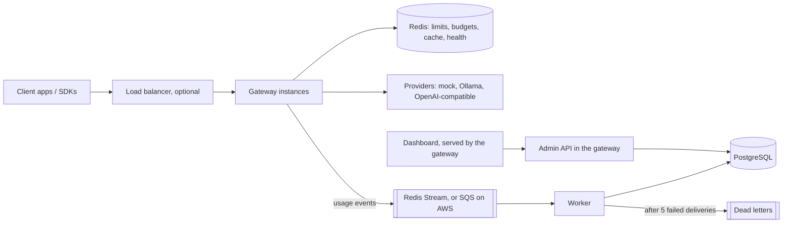
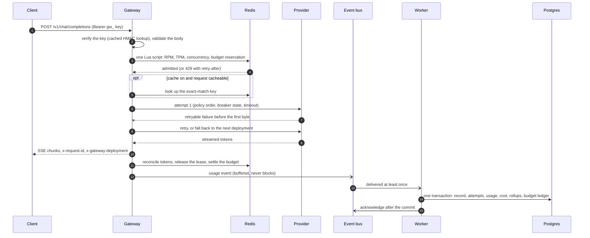

# AI Gateway

**Live demo: <https://ai-gateway-8var.onrender.com>** (the dashboard; the API docs are at
[/docs](https://ai-gateway-8var.onrender.com/docs)). It runs on free hosting that sleeps when
idle, so the first request can take about a minute.

A self-hostable, OpenAI-compatible AI gateway. It sits between your apps and model providers and
adds per-project API keys, rate and token limits, budgets, routing with retries and failover,
circuit breakers, an exact-match cache, and a record of every request with its cost. Everything
runs locally with no paid API and no cloud account: a deterministic mock provider stands in for
real models, and Ollama works too.

**Status: milestones M0-M11 are built.** The MVP (M0-M5), the analytics API (M6), the full
dashboard (M7), observability (M8), benchmarks (M9), the AWS deployment code (M10: Terraform
tested with a mocked provider, [never applied](docs/aws-deployment.md)) and real free providers
with honest costs (M11; the new providers have not been called with real keys yet, see
[docs/providers.md](docs/providers.md)). What comes next is in [docs/ROADMAP.md](docs/ROADMAP.md).
Architecture decisions are in [docs/adr/](docs/adr/), the costs of the main trade-offs in
[docs/trade-offs.md](docs/trade-offs.md).

- `POST /v1/chat/completions` in OpenAI format, streaming and non-streaming; the official OpenAI
  SDKs work unchanged.
- Limits per key and per project (requests/min, tokens/min, concurrent requests) and monthly
  budgets per project, enforced across any number of gateway instances with Redis Lua scripts.
- Routing per model: priority with fallback, weighted, lowest latency or lowest cost; bounded
  retries with jittered backoff (never after the first streamed byte); circuit breakers with
  health checks. Each attempt is stored with the reason it was made.
- Usage accounting through a Redis Stream (or SQS on AWS) into Postgres, exactly once in effect,
  with a dead-letter path; costs from versioned prices.
- Real free-tier providers, each enabled by its key: Groq, Gemini, Mistral, NVIDIA NIM,
  OpenRouter `:free` models, Cloudflare Workers AI and Z.AI. Each request records its list cost
  and what was actually billed ($0 on a free tier); free-tier quotas and 429 cooldowns are shared
  by every instance; budgets route cheapest first above a soft threshold.
- An analytics API over per-minute, hourly and daily rollups: traffic, cost and budgets, model
  comparison, reliability, rejections and pipeline health, for 1 h to 30 days.
- A dashboard on that API: overview, requests with filters and routing history, cost and budgets,
  model comparison, reliability, security, infrastructure, and settings (project, limits and
  budget, members, API keys, deployments and routing), and a Playground that chats through
  `/v1` with a short-lived key. Served by the gateway at `/dashboard/`; usable on a phone.
- Prometheus metrics from the gateway and the worker (token-protected `/metrics`), W3C trace IDs
  on every log line from the request to the worker's insert, and a local Prometheus and Grafana
  stack with a provisioned dashboard.
- Terraform for AWS: a one-instance demo and a full setup (load balancer, two gateways, a worker,
  RDS, ElastiCache, SQS, Secrets Manager, CloudWatch, a budget alert), without NAT gateways, tested
  in CI with a mocked provider. See [Deploying to AWS](#deploying-to-aws).

**Why it exists.** Every app that calls a model API ends up rebuilding the same plumbing: keys
per client, spending limits, retries when a provider fails, and a record of what each request
cost. Doing that in each app means every app gets it slightly wrong, and nobody can see the whole
bill. A gateway does it once, in front of every provider, and its limits have to hold when it
runs on several machines at once, which is where most of the engineering here goes.



### How a request flows



The client's response never waits on Postgres: the request path touches Redis and the provider
only, and the worker writes the record afterwards.

## Run it locally

You need Node 22 (`.nvmrc`), pnpm through corepack (`corepack enable`), and Docker with Compose
v2.20+. [Ollama](https://ollama.com) is optional.

```bash
pnpm install
cp .env.example .env
# Set API_KEY_PEPPER in .env to a random secret of 32+ characters:
openssl rand -hex 32
docker compose up -d   # Postgres 16 and Redis 7, on 127.0.0.1 only
pnpm db:seed           # migrations, a demo project, an admin and an API key (printed once)
pnpm dev               # gateway on :8080, worker, dashboard on :5173/dashboard/
```

On Windows, run `pnpm` from PowerShell (pnpm scripts can fail from Git Bash). Without `openssl`,
generate the pepper with a cryptographic random source:

```powershell
$b = New-Object byte[] 32; [Security.Cryptography.RandomNumberGenerator]::Create().GetBytes($b)
-join ($b | ForEach-Object { $_.ToString('x2') })
```

`pnpm db:seed` prints an admin email and password and an API key. Keep them: they are not shown
again (running it again adds a new key and keeps the admin's password).

Send a request with the key:

```bash
export GW_KEY=gw_...   # the key db:seed printed
curl -s http://127.0.0.1:8080/v1/chat/completions \
  -H "authorization: Bearer $GW_KEY" -H 'content-type: application/json' \
  -d '{"model": "mock-1", "messages": [{"role": "user", "content": "Hello"}]}'
```

Add `"stream": true` for server-sent events. Then:

- Open the dashboard at <http://127.0.0.1:5173/dashboard/> and log in with the seeded admin.
  The Vite dev server proxies `/admin`, `/v1` and `/ready` to the gateway (`GATEWAY_URL`). To
  have the gateway serve a built dashboard instead, run `pnpm build` and set
  `DASHBOARD_DIR=../dashboard/dist`; it is then at <http://127.0.0.1:8080/dashboard/>.
- Open the API docs at <http://127.0.0.1:8080/docs>; **Authorize** with the key to try `/v1`.

### The two-minute demo

With the stack running, `pnpm demo` shows a rate limit and a provider failover against your
gateway. It logs in as the seeded admin, creates two temporary keys, and revokes them at the end.

```bash
ADMIN_PASSWORD='<password db:seed printed>' pnpm demo
# PowerShell: $env:ADMIN_PASSWORD='<password>'; pnpm demo
```

1. **Rate limit**: a key limited to 5 requests per minute sends 8; the last 3 get
   `429 rpm_limit_exceeded` with `retry-after`.
2. **Failover**: `mock-failover` routes to `mock-error` (always HTTP 500) and then `mock`. The demo
   prints each request's routing history from the admin API: a retry, the fallback, and, after 5
   failures, the circuit breaker skipping the failing deployment.

`GATEWAY_URL` (default `http://127.0.0.1:8080`) and `ADMIN_EMAIL` (default `admin@example.com`)
point it elsewhere.

### Everything in containers

```bash
docker compose --profile full up -d --build
```

This adds the gateway (:8080) and the worker. The gateway image includes the built dashboard
and serves it at <http://127.0.0.1:8080/dashboard/> (`/` redirects there), on the same origin as
the admin API. Compose reads `API_KEY_PEPPER` from `.env`. For a first admin and key,
either set `BOOTSTRAP_ADMIN_EMAIL`, `BOOTSTRAP_ADMIN_PASSWORD` and `BOOTSTRAP_API_KEY` (from
`pnpm key:generate`) in `.env`, or run `pnpm db:seed` on the host, which reaches the same Postgres.
In Compose the gateway reaches Ollama on the host at `host.docker.internal:11434`. Add
`--profile observability` for Prometheus and Grafana ([Observability](#observability)).

### Tests

| Command | What it runs |
| --- | --- |
| `pnpm test` | Unit tests; no services needed |
| `pnpm test:int` | Integration tests against Compose Postgres and Redis (`docker compose up -d` first): API contracts, isolation, Lua limits across two instances, routing and breakers, the usage pipeline, the OpenAI SDK |
| `pnpm test:e2e` | The dashboard in Chromium at 375 px, with API answers from fixtures (`pnpm --filter @ai-gateway/dashboard exec playwright install chromium` once) |
| `pnpm check:dashboard-data` | Fails on hand-written numbers in dashboard chart data |
| `pnpm bench:report --check` | Fails when [docs/benchmarks.md](docs/benchmarks.md) differs from what the committed benchmark results generate |
| `pnpm lint`, `pnpm typecheck`, `pnpm format` | ESLint, `tsc`, Prettier |
| `terraform test` in `infra/terraform/{modules/network,demo,full}` | The AWS Terraform against a mocked provider; see [Deploying to AWS](#deploying-to-aws) |

The SQS tests run against LocalStack and skip without it: start it with
`docker compose --profile aws-local up -d` before `pnpm test:int` (CI does, and fails if it is
missing). No test reaches AWS.

CI (GitHub Actions) runs all of them plus the container builds on every push. The SIGTERM
process tests skip on Windows, where signals do not run handlers; they run in CI.

#### Failure scenarios and their tests

| Scenario | Where it is tested |
| --- | --- |
| Authentication and project isolation | `apps/gateway/test/api-key-auth.test.ts`, `admin.test.ts` (another project's resources answer 404), `analytics.test.ts` |
| Key revocation and rotation grace | `apps/gateway/src/auth/key-verifier.test.ts`, `apps/gateway/test/admin.test.ts` |
| Provider adapters normalizing success and errors | `apps/gateway/src/providers/*.test.ts` (Ollama, OpenAI-compatible, mock) |
| Streaming: mid-stream provider drop, client disconnect | `apps/gateway/src/proxy/chat-completions.test.ts`, `apps/gateway/test/chat-completions.test.ts` |
| Timeouts (per attempt, first token, idle stream) | `apps/gateway/src/proxy/chat-completions.test.ts`, `attempt.test.ts` |
| Retry and fallback, never after the first byte | `apps/gateway/test/routing-acceptance.test.ts`, `apps/gateway/src/routing/*.test.ts` |
| Circuit-breaker transitions | `apps/gateway/src/routing/breaker.test.ts`, `routing-acceptance.test.ts` |
| Rate limits under concurrency across two instances | `apps/gateway/test/limits-acceptance.test.ts` |
| Budget reservation, reconciliation and expiry | `apps/gateway/test/limits-acceptance.test.ts`, `apps/worker/test/ledger.test.ts` |
| Duplicate usage events | `apps/worker/test/consumer.test.ts`, `sqs-consumer.test.ts` |
| Cache keys and cross-project isolation | `apps/gateway/src/cache/*.test.ts`, `apps/gateway/test/cache.test.ts` |
| Postgres unavailable | `apps/worker/test/postgres-outage.test.ts` (both consumers hold their batch and store it once), `apps/gateway/test/ready.test.ts` |
| Redis unavailable, both fail modes | `apps/gateway/test/limits-acceptance.test.ts`, `apps/worker/test/worker.test.ts` |
| Worker restart and stuck messages | `apps/worker/test/consumer.test.ts`, `sqs-consumer.test.ts` (killed before and after the commit) |

## Using the API

Point any OpenAI client at the gateway:

```ts
import OpenAI from 'openai';

const client = new OpenAI({ baseURL: 'http://127.0.0.1:8080/v1', apiKey: process.env.GW_KEY });
const stream = await client.chat.completions.create({
  model: 'mock-1',
  messages: [{ role: 'user', content: 'Hello' }],
  stream: true,
});
for await (const chunk of stream) process.stdout.write(chunk.choices[0]?.delta.content ?? '');
```

| Endpoint | Meaning |
| --- | --- |
| `POST /v1/chat/completions` | OpenAI chat completions. `stream: true` returns SSE chunks ending with `data: [DONE]`; `stream_options.include_usage` adds a usage chunk. |
| `GET /v1/models` | OpenAI model list: the models this key's project may use that have an enabled deployment. `created` is when the gateway loaded its models file. |
| `/admin/...` | Admin API used by the dashboard; see [Admin API](#admin-api). |
| `GET /dashboard/` | The dashboard, when the gateway has a built one (`DASHBOARD_DIR`, set in the image); `GET /` redirects to it, or to `/docs` without one. |
| `GET /docs` | Swagger UI; the OpenAPI 3.1 spec is at `/docs/json`. |
| `GET /health` | The process is up. |
| `GET /ready` | 200 when Postgres and Redis answer within `READY_CHECK_TIMEOUT_MS`, else 503 naming the failing check. |

The body accepts OpenAI's text chat parameters (`messages`, `max_tokens` or
`max_completion_tokens`, `temperature`, `top_p`, `stop`, `seed`, penalties, `user`) and rejects
anything else (tools, `response_format`, images, `n > 1`) with a 400 naming the field. Bodies
over 1 MiB get 413. Every response has a server-generated `x-request-id`; the logs for that
request carry it as `requestId`, and each upstream call is logged once with its `attemptId`.
A completion also names the deployment that answered in `x-gateway-deployment` and, after a
fallback, the deployments passed over first in `x-gateway-fallback-from` (they failed, or their
circuit breaker was open).

Browser pages on other origins may call `/v1` when their origin is listed in `ALLOWED_ORIGINS`
(comma-separated exact origins, empty by default; ADR 021). They may send `Authorization` and
read `x-request-id`, the two routing headers, `x-gateway-cache` and `retry-after`. The admin API
and every other path never answer other origins.

### Errors

Errors use the OpenAI shape `{"error": {"message", "type", "param", "code"}}` and never include
stack traces or a provider's own error text. `x-should-retry` tells OpenAI SDKs whether a retry
can help.

| Status | `code` | When |
| --- | --- | --- |
| 400 | `invalid_request` | The body failed validation. |
| 400 | `request_exceeds_limit` | The request could never fit: more tokens than the TPM limit, or a worst-case cost above the project's per-request cap or whole budget. Lower `max_tokens`. |
| 401 | `invalid_api_key` | Missing, unknown, revoked or expired key. |
| 429 | `too_many_invalid_api_keys` | The client IP sent too many key IDs that do not exist; refused before any key lookup, with `retry-after`. |
| 403 | `model_not_allowed` | The model is outside the project's allow-list. |
| 404 | `model_not_found` | No such model, or none of its deployments is enabled. |
| 429 | `rpm_limit_exceeded`, `tpm_limit_exceeded`, `concurrency_limit_exceeded` | A key or project limit, with `retry-after`. |
| 429 | `budget_exceeded` | The monthly budget is used up; `retry-after` is the start of next month. |
| 429 | `upstream_rate_limited` | The last deployment tried was rate limited by its provider. |
| 502 | `upstream_error`, `upstream_unavailable`, `upstream_invalid_response`, `upstream_auth_failed`, `upstream_model_not_found` | The providers tried failed or are misconfigured (the last failure is reported). |
| 503 | `deployments_unavailable` | Every deployment of the model has an open circuit breaker. |
| 503 | `limits_unavailable` | Redis is unreachable and `LIMITS_FAIL_MODE=closed`; only requests with limits are affected. |
| 504 | `upstream_timeout` | The deployment's timeout passed. |

A failure after a stream has started is sent as a final `{"error": ...}` event and the stream
ends without `[DONE]`.

## Models and routing

Clients send a logical model name. [apps/gateway/config/models.json](apps/gateway/config/models.json)
(or the file in `MODELS_CONFIG_PATH`) maps each name to deployments: an adapter (the wire
protocol), the provider's name, its own model name, timeouts and an output cap. The file is
validated at startup.

| Adapter | Talks to | Notes |
| --- | --- | --- |
| `mock` | nothing (in-process) | Deterministic: `latencyMs`, `ttftMs`, `tokensPerSecond`, `completionTokens`, `promptTokens`, `errorRate` with `seed`, `failWith` (`429` or `500`), `retryAfterMs`, `dropAfterTokens`. |
| `ollama` | Ollama's `/api/chat` | `baseUrl` defaults to `OLLAMA_BASE_URL`. |
| `openai-compatible` | any `/v1/chat/completions` API | `apiKeyEnv` names the variable holding the key; without it the deployment is disabled. |

Per deployment, `timeoutMs` bounds a non-streaming call or the wait for a stream's first token,
`streamIdleTimeoutMs` the silence between tokens, and `maxOutputTokens` (4096) is sent upstream
when the client sets no `max_tokens`. A client that disconnects cancels the upstream call. Also
per deployment:

- `adapter` and `provider`: the adapter kind, and who serves it (`groq`, `gemini`, `mistral`,
  `nvidia`, `openrouter`, `cloudflare`, `zai`, `ollama`, `mock`; it defaults to the adapter
  kind). Prices, costs, metrics and the dashboard go by the provider name, so two providers
  serving the same model name keep separate prices. A file that still sets `provider` to the
  adapter kind, as before M11, reads as that adapter.
- `baseUrl` may hold `${NAME}` placeholders filled from the environment at startup (Cloudflare's
  account ID); the deployment is disabled while one is unset.
- `healthCheck`: `models` (default) probes an open breaker with `GET /models`; `none` sends
  nothing, for providers without a model list, and the breaker half-opens after `BREAKER_OPEN_MS`.
- `billing`: `free_tier` or `paid` (default), see [Costs](#costs-list-price-and-what-was-billed).
- `quota`: the provider's published free limits, see
  [Free-tier quotas and cooldowns](#free-tier-quotas-and-cooldowns).

A model names one deployment, or several with a policy:

```json
"mock-failover": {
  "policy": "priority",
  "targets": [{ "deployment": "mock-error" }, { "deployment": "mock" }]
}
```

| Policy | First choice | Then |
| --- | --- | --- |
| `priority` | the first target | the others in order |
| `weighted` | random, in proportion to `weight` | the rest by weight |
| `lowest_latency` | lowest moving average of time to first byte; unmeasured ones first | slower ones |
| `cost_aware` | lowest worst-case cost at current prices (unpriced counts as free) | costlier ones |

A target marked `"lastResort": true` is tried only after every other target, in the order listed,
under any policy: the mock in `chat-fast`, `chat-cheap` and `chat-variety` never wins on latency,
price or weight, but answers when no provider key is set.

- **Retries** (ADR 011): a timeout, rate limit, 5xx or dropped connection is retried on the same
  deployment (`RETRY_PER_DEPLOYMENT`, 2 tries) after a random backoff below
  `RETRY_BASE_DELAY_MS x 2^n` (capped at `RETRY_MAX_DELAY_MS`), then the next target is tried.
  `RETRY_MAX_ATTEMPTS` (3) caps attempts per request. A 400 is never retried, and nothing is
  retried once a stream has sent its first byte.
- **Circuit breakers** (ADR 012): after `BREAKER_FAILURE_THRESHOLD` (5) consecutive failures a
  deployment is skipped for `BREAKER_OPEN_MS` (30 s). Open deployments are health-checked every
  `HEALTH_CHECK_INTERVAL_MS` with a call that runs no model; a pass lets one trial request through,
  and its success closes the breaker. Breakers are per instance; their state is also published in
  Redis and in `provider_health_events`.
- **Routing history**: each attempt is stored with its policy and reason, e.g.
  `priority 2 of 2; fallback after mock-error failed (server_error)`. See it in the dashboard or at
  `GET /admin/requests/:requestId`.
- **Cache** (ADR 013, off by default): with `CACHE_ENABLED=true`, requests with `temperature: 0`,
  or sent with `x-gateway-cache: on`, are answered from an exact-match cache keyed by project,
  model and request. Projects never share entries. Hits count toward request limits but cost
  nothing, and are recorded with `cacheHit: true`. `x-gateway-cache: off` skips the cache.

The default file has these models (each hosted one needs its provider's key; without it the
deployment is disabled and the model answers 404):

| Model | Served by | Needs |
| --- | --- | --- |
| `mock-1` | the mock | nothing |
| `mock-slow`, `mock-rate-limited`, `mock-error`, `mock-flaky`, `mock-drop` | the mock, one failure mode each | nothing |
| `mock-failover` | `priority`: `mock-error`, then `mock` | nothing |
| `mock-balanced` | `weighted`: `mock` ×3, `mock-flaky` ×1 | nothing |
| `chat-default` | `priority`: Groq `openai/gpt-oss-20b`, Gemini `gemini-3.5-flash-lite`, Mistral Small 4, Cloudflare Llama 4 Scout, NVIDIA DeepSeek V4.1 Flash, Z.AI GLM-4.7-Flash, OpenRouter Gemma 4 31B, then `mock` | nothing; each provider joins once its key is set |
| `chat-fast` | `lowest_latency`: Groq gpt-oss-120b and gpt-oss-20b, Gemini 3.1 Flash-Lite, Mistral Small 4, Cloudflare Llama 4 Scout; `mock` as last resort | nothing |
| `chat-cheap` | `cost_aware`: Gemini 3.1 Flash-Lite, Groq gpt-oss-20b, Mistral Small 4, NVIDIA DeepSeek V4.1 Flash, Z.AI GLM-4.7-Flash, Cloudflare Llama 4 Scout; `mock` as last resort | nothing |
| `chat-variety` | `weighted`: Groq gpt-oss-120b ×2, Gemini 3.8 Flash ×2, Mistral Large 4, NVIDIA DeepSeek V4.1 Flash, Z.AI GLM-4.7-Flash, OpenRouter Gemma 4 31B, Cloudflare Llama 4 Scout; `mock` as last resort | nothing |
| `gpt-oss-20b`, `gpt-oss-120b`, `qwen3` | Groq (`qwen/qwen3.8-27b` is a preview model there) | `GROQ_API_KEY` |
| `gemini-3.5-flash-lite`, `gemini-3.8-flash`, `gemini-3.1-flash-lite` | Gemini API | `GEMINI_API_KEY` |
| `mistral-small`, `mistral-large` | Mistral (`mistral-small-2603`, `mistral-large-4`, a public preview) | `MISTRAL_API_KEY` |
| `deepseek-v4.1-flash`, `nemotron-3-super` | NVIDIA NIM | `NVIDIA_API_KEY` |
| `gemma-4-31b` | OpenRouter, `google/gemma-4-31b-it:free` | `OPENROUTER_API_KEY` |
| `llama-4-scout` | Cloudflare Workers AI | `CLOUDFLARE_API_TOKEN` and `CLOUDFLARE_ACCOUNT_ID` |
| `glm-4.7-flash` | Z.AI | `ZAI_API_KEY` |
| `llama3.2` | Ollama, `llama3.2:1b` | a running Ollama |

A deployment whose key variable is empty is disabled at startup (the log says which), and a
model with no enabled deployment answers 404. `chat-default`, `chat-fast`, `chat-cheap` and
`chat-variety` always answer: with no keys they are the mock. With only the Groq and Gemini keys,
`chat-default` is Groq, then Gemini, then the mock, as before M11.

The mock also runs as a standalone HTTP server speaking the OpenAI wire format
(`POST /v1/chat/completions` with or without streaming, `GET /v1/models`, `GET /stats` for its
counters), so a gateway reaches it through an `openai-compatible` deployment and a client can
call it directly; the benchmarks use it as their upstream. `pnpm mock:serve` starts it on
`MOCK_HOST:MOCK_PORT` (`127.0.0.1:8090`); `MOCK_SETTINGS` is a JSON object with the same fields
as a deployment's `mock` block, e.g. `MOCK_SETTINGS='{"latencyMs":50,"completionTokens":32}'`.
In a container image it is `node dist/mock-server/main.js`.

### Using real providers

Every hosted provider speaks the OpenAI wire format, so all of them use the `openai-compatible`
adapter; no provider code is specific to one. Each has a free tier that needs no credit card.

1. Create a key: Groq <https://console.groq.com/keys>, Gemini <https://aistudio.google.com/apikey>,
   Mistral <https://console.mistral.ai/api-keys>, NVIDIA <https://build.nvidia.com>, OpenRouter
   <https://openrouter.ai/settings/keys>, Cloudflare (an API token with Workers AI access, and the
   account ID from the dashboard), Z.AI <https://z.ai/manage-apikey/apikey-list>.
2. Put it in `.env` (never commit it) under the name in [.env.example](.env.example), then restart
   `pnpm dev`. With Compose, the `full` profile passes them all through to the gateway. On a host
   such as Render, set them as environment variables of the gateway service.
3. Call `chat-default` (or any model in the table above):

```bash
curl -s http://127.0.0.1:8080/v1/chat/completions -H "Authorization: Bearer $GATEWAY_KEY" \
  -H 'content-type: application/json' \
  -d '{"model":"chat-default","messages":[{"role":"user","content":"Say hi"}]}'
```

If Groq fails, is rate-limited or has used its free quota, the request falls back to the next
provider, and finally to the mock; the request's routing history in the dashboard shows each
attempt and why.

| Provider | Free limit (as published) | Quota in the models file | Source, checked |
| --- | --- | --- | --- |
| Groq | 30 requests/min, 1,000/day, 8,000 tokens/min, 200,000 tokens/day per model | the same, per deployment | [rate limits](https://console.groq.com/docs/rate-limits), 2026-11-03 |
| Gemini API | per project, shown only in AI Studio | none | [rate limits](https://aistudio.google.com/docs/rate-limits), 2026-11-03 |
| Mistral | "restrictive", shown only in the console | none | Mistral docs, 2026-11-03 |
| NVIDIA NIM | no official figure (forum reports 40/min) | none | 2026-11-03 |
| OpenRouter `:free` | 20/min; 50/day per account without purchased credits | 20/min, 50/day | [limits](https://openrouter.ai/docs/api/reference/limits), 2026-11-03 |
| Cloudflare Workers AI | 10,000 Neurons/day; 300 requests/min | 300/min; 129,000 tokens/day (derived from the Neurons) | [pricing](https://developers.cloudflare.com/workers-ai/platform/pricing/), [limits](https://developers.cloudflare.com/workers-ai/platform/limits/), 2026-11-03 |
| Z.AI | GLM-4.7-Flash free; no published rate limit | none | [pricing](https://docs.z.ai/guides/overview/pricing), 2026-11-03 |

[docs/providers.md](docs/providers.md) has every model ID, list price and limit with its source
and the date it was checked, and how each list price was chosen for endpoints that have none of
their own. The list prices are inserted by a migration (`0006_provider-prices.sql`), so every
database has them, the live demo included; prices are versioned and never edited (ADR 016).

Free tiers have low limits, and Google's pricing page says content sent on the Gemini free tier
is used to improve its products (on the paid tier it is not); check each provider's terms before
sending real data. `qwen3` and Mistral Large 4 are preview models: they may be withdrawn at short
notice, so neither is in `chat-default`.

Groq and Gemini were checked with real keys on 2026-10-21. No key for the providers added in M11
was available when they were built (2026-11-03), so they are configured from their documentation
and have not been called yet; the first real call of each is a step in PLAN-NOTES.

## Playground

The dashboard's Playground page chats with the project's models through the public
OpenAI-compatible API, so a reply goes through everything a client's request does: limits, the
budget, routing with retries and fallback, the cache, and usage and cost tracking (ADR 021).

- **Key:** when the page opens, the dashboard creates an API key named `playground` for the
  selected project through the admin API (`expiresInSeconds: 3600`). The key is held only in
  the page's memory and sent only to `/v1` on the same origin. It is revoked when you leave the
  page, switch project or close the tab, replaced five minutes before it expires, and the gateway
  refuses it after the hour in any case. Its requests appear under that key on every page.
- **Your own key:** tick "Use my own API key" and paste a `gw_` key to call `/v1` with it
  instead; the automatic key stays the default and is used again when the field is empty. The
  pasted key is held only in the page's state (never in browser storage or the URL) and forgotten
  when you untick the option, leave the page or switch project. The line above the chat always
  says which key is in use, by its public part (`gw_<keyId>_…`) and its name when it is one of
  the project's keys; a key of another project is used with that project's limits, budget and
  models.
- **Who:** creating keys needs the `admin` or `owner` role, so viewers see an explanation instead.
- **Chat:** the model list comes from `GET /v1/models`; replies stream in, with Stop and New
  chat. Under each reply: the model, the provider and deployment that served it, any deployments
  it fell back from, latency (first text and total, measured in the browser), tokens, the cost
  the worker recorded for it, and a link that opens the request on the Requests page in a new tab.
  The conversation is kept in the page only.
- **Errors:** a rejected or expired key (with "Start a new key", or "Use the automatic key" for
  a pasted one), a model the project may not use,
  a rate limit or spent budget (with the retry time) and an unavailable gateway each get their
  own message.

`ALLOWED_ORIGINS` (empty by default) still lets browser apps on other origins call `/v1` with
their own keys; the Playground does not need it.

## Limits and budgets

Limits are set per project (all its keys together) and per API key with the admin API, where
`null` means no limit. Each request's checks run in one Redis Lua script that takes all of them or
none, so they hold across instances (ADR 008).

```bash
curl -s -X PATCH "http://127.0.0.1:8080/admin/projects/$PROJECT_ID" \
  -b "gw_session=$SESSION" -H 'content-type: application/json' \
  -d '{"limits": {"requestsPerMinute": 60, "tokensPerMinute": 100000, "concurrentRequests": 10},
       "budget": {"monthlyLimitMicroUsd": 5000000, "maxRequestCostMicroUsd": 50000,
                  "softThresholdPct": 80}}'
```

| Setting | How it works |
| --- | --- |
| `requestsPerMinute` | Token bucket, refilled evenly over the minute. |
| `tokensPerMinute` | Token bucket: reserves the estimated prompt plus the output cap before the call, then is corrected to the tokens actually used. |
| `concurrentRequests` | Leases that running requests renew; a crashed instance's leases expire after `LIMITS_LEASE_TTL_MS` (30 s). |
| `budget.monthlyLimitMicroUsd` | Per UTC month, in micro-dollars ($1 = 1,000,000). Each request reserves its worst-case cost and is charged its actual cost after (ADR 009). |
| `budget.maxRequestCostMicroUsd` | The most one request may reserve; a costlier request gets a 400. |
| `budget.softThresholdPct` | From this share of the monthly budget (default 80%), routing tries the cheapest deployments first, whatever the model's policy, and records why on the attempt (`budget at 82%: cheapest first; ...`). At 100% requests are refused. Editable in Settings → Limits and budget; every change is audited. |

Rejections are recorded as `rejected` requests. Spend stays within **budget + requests in flight
x max request cost**: a request costs more than it reserved only when the provider counts more
prompt tokens than the gateway estimated, or its reservation expired while it ran. Postgres keeps
each project's monthly spend; if Redis loses its data (a restart with no persistence), the totals
are rebuilt from Postgres instead of starting from zero. Models with no price cost nothing.

If Redis is unreachable, `LIMITS_FAIL_MODE=closed` (default) answers 503 to requests that have a
limit or budget, and `open` admits them unchecked (ADR 010). Requests with no limits skip the
limit scripts; their only Redis call is the free-tier quota and cooldown check, which fails open
(ADR 025).

Budgets count list cost, so they work on free tiers too (ADR 024). To see one work, give a demo
project a tiny budget: in Settings → Limits and budget set the monthly budget to `0.02` (dollars)
and the cheapest-first threshold to `50`, or with the API:

```bash
curl -s -X PATCH "http://127.0.0.1:8080/admin/projects/$PROJECT_ID" \
  -b "gw_session=$SESSION" -H 'content-type: application/json' \
  -d '{"budget": {"monthlyLimitMicroUsd": 20000, "softThresholdPct": 50}}'
```

Then send requests (the Playground works) until the budget runs out: below 50% each request goes
to the route's first choice; above it the Requests page shows `budget at NN%: cheapest first` on
each attempt; once spent, requests get a 429 `budget_exceeded` until the next UTC month. The Cost
page's budget meter follows along. An integration test does exactly this
(`apps/gateway/test/budget-soft-threshold.test.ts`).

## Costs: list price and what was billed

Each request stores two costs, both fixed when the worker ingests it (ADR 024):

- **List cost**: its tokens at the model's price in `model_prices`, versioned (ADR 016). Budgets
  count this, so a budget means the same on a free tier as on a paid one.
- **Billed cost**: what the provider charges: 0 for a deployment with `billing: free_tier`, the
  list cost for `paid`. Changing a deployment's billing later never changes past rows.

The Overview and Cost pages show both and the difference as **saved**; each breakdown on the Cost
page has a Billed column. A model with no list price (some free endpoints have no paid version
anywhere) shows "no list price", never $0. Free endpoints without a price of their own use the
model maker's paid price, or OpenRouter's paid listing of the same model; the source of each is in
[docs/providers.md](docs/providers.md).

**What it would cost elsewhere.** `GET /admin/analytics/cost-comparison` (a card on the Cost page)
prices the range's prompt and completion tokens under every priced model, cheapest first. It
includes reference prices of a few paid models the gateway never calls (`model_prices.reference`);
the router, budgets and the worker never read those rows. Each model counts tokens with its own
tokenizer, so these are estimates.

## Free-tier quotas and cooldowns

A deployment's `quota` (`requestsPerMinute`, `requestsPerDay`, `tokensPerMinute`,
`tokensPerDay`) holds the provider's published free limits. Every instance counts in the same
Redis keys, in fixed UTC minutes and days, with one Lua script per try (ADR 025):

- A deployment whose quota would be exceeded is skipped, and the next attempt says why:
  `skipped groq-gpt-oss-120b (quota, 1,000 of 1,000 requests today)`. If nothing is left, the
  request gets a 429 `upstream_quota_exhausted` with `retry-after` until the window ends.
- Tokens are counted up front (prompt estimate plus output cap) and corrected to the reported total
  when the try ends; `x-ratelimit-*` headers whose limit matches a quota raise the count to the
  provider's own.
- An upstream 429 puts the deployment on a cooldown for its `Retry-After` (or
  `PROVIDER_COOLDOWN_MS`, 30 s), and every instance skips it until then.
- If Redis is down, quota checks fail open: the provider's own 429 still protects the quota, and a
  free tier cannot overspend money.

The Models page shows each deployment's use today against its quota, as a meter, and any running
cooldown (`GET /admin/models/quotas`). Prometheus has `gateway_provider_skips_total`,
`gateway_provider_cooldowns_total` and `gateway_provider_quota_used_ratio`.

## Scheduled traffic

[.github/workflows/traffic.yml](.github/workflows/traffic.yml) runs
[scripts/traffic.mjs](scripts/traffic.mjs) every two hours (and on demand from the Actions tab),
so the live demo's real providers carry some traffic and the dashboard has data. Each run waits up
to two minutes for the sleeping host to wake, then sends six requests: `chat-default`,
`chat-fast` and `chat-variety` streamed, `chat-cheap`, and one prompt twice at temperature 0 for
the cache. Output caps are 8 to 48 tokens. CI runs `node scripts/traffic.mjs --dry-run`, which
prints the plan and sends nothing. The job is skipped on forks, and without its secrets its steps
are skipped and it succeeds.

What it sends a day, against the free limits: 12 runs × 6 requests = **72 requests a day**, each
under about 150 tokens with the providers' own prompt overhead, so **under about 11,000 tokens a
day** in all. That is under 8% of one Groq model's 1,000 requests and 6% of its 200,000 tokens a
day, under 9% of Cloudflare's 129,000-token daily quota, and far from the 30/min and 20/min
limits; OpenRouter's 50 a day is reached only if almost everything else fails, and its quota then
skips it. Gemini, Mistral, NVIDIA and Z.AI publish no per-model numbers.

To turn it on (once):

1. In the live dashboard, log in as the owner and pick the project the traffic should count
   against (a separate "demo traffic" project keeps it apart; Settings → Limits and budget can
   give it a budget, such as $1 a month).
2. Settings → API keys → create a key named `traffic`, and copy it (it is shown once).
3. On GitHub, Settings → Secrets and variables → Actions → New repository secret: add
   `DEMO_BASE_URL` (the demo's URL, e.g. `https://ai-gateway-8var.onrender.com`) and
   `DEMO_API_KEY` (the key).
4. Actions → Traffic → Run workflow, to check one run by hand. To stop it, delete either secret or
   disable the workflow; revoking the key in Settings stops it at the gateway.

## API keys and the admin API

Keys look like `gw_<keyId>_<secret>` (ADR 006). Only an HMAC-SHA256 of the secret, keyed with
`API_KEY_PEPPER`, is stored, and the full key is shown once. Each instance caches a verified key
for `API_KEY_CACHE_TTL_MS` (30 s); revoking or rotating a key, or changing a project's settings,
tells every instance through Redis pub/sub, and the TTL bounds the delay if that message is lost.
Rotation keeps the old key working for a grace period (default
`API_KEY_ROTATION_GRACE_SECONDS`). A project's `allowedModels` limits the models its keys may call.

A key ID that is not in the database costs one lookup, then is remembered in Redis for
`UNKNOWN_KEY_CACHE_MS` (60 s), so repeats are refused without one. Each client IP may send
`UNKNOWN_KEYS_PER_MINUTE_PER_IP` (30) unknown key IDs a minute; after that, its requests with a
key ID not known to exist get 429 `too_many_invalid_api_keys` before any lookup. Key IDs found in
the database are remembered too, and are never limited, so valid keys keep working from an
address that also sent unknown ones. Creating a key clears its ID through the same pub/sub
message. If Redis is down, keys are looked up as before. Prometheus counts these requests in
`gateway_unknown_api_keys_total{result="rejected"|"limited"}`; the client IP is only in the log
line. Behind a proxy, set `TRUST_PROXY` (below), or every client shares one address.

### Admin API

`POST /admin/auth/login` sets an HTTP-only, `SameSite=Strict` session cookie that every other admin
route requires (ADR 007). Roles are per project: `viewer` reads, `admin` also manages keys and
settings, `owner` also manages members.

| Route | Role |
| --- | --- |
| `POST /admin/auth/login`, `POST /admin/auth/logout`, `GET /admin/me` | any user |
| `GET /admin/projects`, `POST /admin/projects` (the creator becomes owner) | any user |
| `GET /admin/projects/:projectId` | viewer |
| `PATCH /admin/projects/:projectId` (name, `allowedModels`, `limits`, `budget`) | admin |
| `GET /admin/analytics/...` (see [Analytics](#analytics)) | viewer |
| `GET /admin/requests/:requestId`: the request, its usage and every attempt with its routing reason | viewer |
| `GET /admin/projects/:projectId/members` | viewer |
| `POST`, `PATCH`, `DELETE /admin/projects/:projectId/members[/:userId]` | owner |
| `GET /admin/projects/:projectId/api-keys` | viewer |
| `POST .../api-keys` (name, `limits`, optional `expiresInSeconds`), `PATCH .../api-keys/:apiKeyId` (name, `limits`), `.../revoke`, `.../rotate` | admin |
| `GET /admin/projects/:projectId/audit-logs` | admin |

Another project's resources answer 404, exactly like ones that do not exist. Every change writes
an `audit_logs` row in the same transaction. Logins are limited per email and per client IP
(`LOGIN_ATTEMPTS_PER_MINUTE`, `LOGIN_ATTEMPTS_PER_MINUTE_PER_IP`); behind a proxy, set
`TRUST_PROXY` to the number of proxies in front so the client IP is the real one.

## Dashboard

Nine pages, read from the admin and analytics APIs (the Playground also calls `/v1`); nothing is
computed or filled in by the dashboard, and a page with no data says so. The top bar picks the project and the time range
(1 h, 24 h, 7 d, 30 d); pages live in the URL hash (`#cost`, `#settings/keys`), so links and
reloads keep them. Dark is the default theme, with a light one in the top bar.

| Page | Shows |
| --- | --- |
| Overview | KPI cards (requests, error rate, p95 latency, cost, cache hits) with sparklines, requests by outcome over time, recent requests, spend this month against the budget, gateway readiness |
| Requests | Filters (status, key, model, provider), a dense paginated list with latency bars, and a side panel with each request's attempt timings and routing history |
| Cost | KPI cards (spend, cost per request, tokens, projected month or "not enough data"), cost per interval, spend by model as shares, breakdowns by project, key, provider and model with each row's share, budgets as meters |
| Models | p50/p95 latency bars, a table of latency, TTFT, tokens per second, cost, failure and fallback rates (not answer quality), every deployment with its breaker state |
| Reliability | KPI cards for failures, retries, fallbacks and attempts; their trend; errors by code; each deployment's numbers; breaker states per instance and their changes |
| Security | Rejections by kind (limits, budget, model policy), over time, by reason and by key with shares |
| Infrastructure | Worker lag, pending events, dead letters and dependency checks, the pipeline in detail, and the answering instance's process readings |
| Playground | A chat through `/v1` with a short-lived key for the project; see [Playground](#playground) |
| Settings | Tabs: Project (name, ID, allowed models), Limits and budget (each limit with the busiest minute of the last hour as a meter, the month's spend against the budget), Members, API keys, Routing (read-only, from the models file) |

Some things are shown as "not measured" or "not tracked" because the gateway does not record
them: change against a previous period, deployment uptime, in-flight requests against the
concurrency limit, and when a key was last used. Each has a row in
[docs/PLAN-NOTES.md](docs/PLAN-NOTES.md). Models come from the models file, so there is no
"add model" button. The design system (tokens, shell, shared components) is ADR 020.

Viewers see every page but no control that changes anything; admins also manage keys, limits
and project settings, and owners also manage members. The API enforces the same roles.

## Analytics

Read-only endpoints for the dashboard, one per section (ADR 015). Each takes `range` (`1h`,
`24h`, `7d` or `30d`; anything else is a 400 listing them) and the filters `projectId`,
`apiKeyId`, `provider`, `model` and `status`. Without `projectId` they cover every project the
caller belongs to; another project's ID is a 404.

| Route | What it returns |
| --- | --- |
| `GET /admin/analytics/overview` | Counts by status, tokens, cost, latency and TTFT percentiles, a request-rate series, spend this month |
| `GET /admin/analytics/requests?limit&cursor` | Requests in the range, newest first, keyset-paginated |
| `GET /admin/analytics/models` | Per model and deployment: latency, TTFT, output tokens per second, cost, failure and fallback rates |
| `GET /admin/analytics/cost` | Spend by provider, model, project and key; a cost series; budgets with alerts at 80% and 100%; a monthly projection |
| `GET /admin/analytics/reliability` | Errors by code, retries, fallbacks per deployment, breaker states and changes |
| `GET /admin/analytics/security` | Rejections by reason (rate, token, concurrency, budget, policy) and by key |
| `GET /admin/analytics/infra` | Usage stream length, unread and pending events, dead letters, Postgres and Redis round trips, measured now |

The worker keeps rollups per minute, hour and day in the same transaction as the request rows, so
totals always match the stored requests and a re-delivered event changes nothing. `1h` and `24h`
read minute rows, `7d` hourly rows and `30d` daily rows (UTC); series have 60, 96, 168 and 30
points. Percentiles come from latency histograms (10 ms to 120 s) and are approximate. The
projection is null, with a reason, until there are 7 full days of data. Retention:
`ROLLUP_RETENTION_MINUTE_HOURS` (48), `ROLLUP_RETENTION_HOUR_DAYS` (35), `ROLLUP_RETENTION_DAY_DAYS`
(400).

Speed and cost comparisons say nothing about answer quality. Requests with an invalid API key are
refused before a project is known, so they are not counted per project.

## Usage accounting

Each `/v1` request that passes authentication and validation becomes one `request.completed`
event with its status, timings, attempts and tokens, never its prompt or output. The gateway hands
it to a bounded in-memory buffer and returns; a background loop writes it to a Redis Stream. While
Redis is down, events wait in the buffer (`EVENTS_BUFFER_MAX`); past that they are dropped and
counted in the logs.

On AWS, `EVENT_BUS=sqs` sends the events to an SQS queue instead (ADR 023); the worker then reads
the queue, with the same guarantees and a dead-letter queue, and needs no Redis.

The worker (ADR 014) reads the stream in a consumer group, writes each batch in one transaction
with `ON CONFLICT DO NOTHING`, and acknowledges only after the commit: a crash re-delivers, and a
re-delivery changes nothing. Entries left by a dead worker are claimed after
`WORKER_CLAIM_IDLE_MS`; an entry delivered more than `WORKER_MAX_DELIVERIES` times goes to a
dead-letter stream and the `failed_events` table. If Redis restarts empty, the worker recreates
its consumer group.

`usage_source` is `reported` (by the provider), `estimated` (by the gateway's tokenizer
approximation, when a stream was cut off or the provider sent no counts) or `missing`. Cost, in
integer micro-dollars, uses the `model_prices` version in effect when the request started
(ADR 016); price rows are immutable, so past costs never move. Each usage row also stores the
billed cost and the deployment's billing (ADR 024). `pnpm db:seed` adds a demo price for the mock
provider; the real providers' list prices come with the migrations.

Migrations are plain SQL in [db/migrations](db/migrations) (ADR 003), applied at startup under a
Postgres advisory lock (`MIGRATE_ON_START`), or by hand with `pnpm db:migrate`.

### Data model

UUIDv7 keys, `timestamptz` everywhere, money as integer micro-dollars, constraints in the
migrations.

| Tables | Hold |
| --- | --- |
| `users`, `user_sessions`, `project_members` | Dashboard users (argon2id passwords), sessions, roles per project |
| `projects`, `api_keys` | Tenants with their limits, budget and allowed models; keys as `key_id` plus an HMAC of the secret |
| `model_deployments`, `routing_policies` | What the dashboard shows and edits about routing (the models file is the source) |
| `model_prices` | Versioned, immutable prices (`effective_from`) |
| `request_records`, `provider_attempts`, `usage_events` | One row per request, per upstream attempt with its routing reason, and per usage event (`UNIQUE(event_id)`) |
| `budget_periods`, `budget_reservations` | The monthly spend ledger and the audit of each reservation |
| `usage_rollups_minute`, `_hour`, `_day` | Analytics with latency histogram buckets (ADR 015) |
| `provider_health_events`, `audit_logs`, `failed_events` | Breaker transitions, every admin change, dead-lettered events |

### Security decisions

- **API keys** (`gw_<keyId>_<secret>`): high-entropy, so an HMAC-SHA256 with a server pepper is
  enough and lookups are by `keyId`; the plaintext is shown once (ADR 006).
- **Dashboard users**: argon2id passwords, an HTTP-only `SameSite=Strict` session cookie
  (HTTPS-only in production), roles per project, logins limited per email and per IP (ADR 007).
- **Tenancy**: every query on a project's data filters by the caller's project; another
  project's resources answer 404, exactly like missing ones.
- **No prompts or completions stored** by default; the optional cache keeps completions in Redis
  for its TTL and only a hash of the prompt (ADR 013).
- **Limits fail closed** when Redis is down, unless `LIMITS_FAIL_MODE=open` (ADR 010).
- **Untrusted upstreams**: provider errors are normalized and never passed to clients raw; model
  output never changes policy.
- **Logs** redact API keys, authorization headers and provider credentials.
- **The dashboard** is served by the gateway with a strict Content-Security-Policy; `/v1` CORS is
  off unless `ALLOWED_ORIGINS` lists exact origins (ADR 021).
- **On AWS**: no SSH (Session Manager), IMDSv2 only, private and encrypted data stores, TLS to
  Postgres (verified) and Redis, secrets in Secrets Manager read at boot, one IAM role per
  instance kind with only what it uses (ADR 022).

## Observability

Operational metrics are separate from the analytics above (ADR 017): Prometheus metrics from
each process, and trace IDs in the JSON logs.

**Local Prometheus and Grafana.** Both bind to 127.0.0.1. Run them only while you need them:

```bash
docker compose --profile full --profile observability up -d --build
# Grafana: http://127.0.0.1:3001 (anonymous, read-only; opens the "AI Gateway" dashboard)
# Prometheus: http://127.0.0.1:9090/targets (gateway and worker should be up)
docker compose --profile full --profile observability stop prometheus grafana
```

Prometheus scrapes the gateway's and worker's private metrics ports on the Compose network,
which are not published to the host, so no token is involved. Grafana's datasource and
dashboard are provisioned from [infra/compose/observability/](infra/compose/observability/). The
dashboard shows traffic, latency p50/p95, 5xx and failed attempts, rejections, retries and
fallbacks, breakers, TTFT, stream lag and pending, the dead-letter stream, buffered and dropped
events, cache hit ratio, estimate error, batch times and memory. History is kept for one day.

**Scraping a gateway.** `GET /metrics` on the gateway's port exists only when `METRICS_TOKEN` is
set (32+ characters), and needs `Authorization: Bearer <token>`. A missing or wrong token gets
401; with no token set, the route is a 404. `METRICS_PORT` adds a separate listener on
`METRICS_HOST` (default 127.0.0.1). The worker always serves its own on `WORKER_METRICS_PORT`
(default 9465). Both need the token only if one is set.

```bash
curl -H "Authorization: Bearer $METRICS_TOKEN" http://127.0.0.1:8080/metrics
```

| Metric | Labels | What it counts |
| --- | --- | --- |
| `gateway_http_request_duration_seconds` | method, route, status_code | HTTP requests until the response ended; `_count` is the request count |
| `gateway_upstream_attempts_total` | provider, deployment, model, outcome | Provider attempts; outcome is `success` or the error kind |
| `gateway_retries_total` / `gateway_fallbacks_total` | deployment / model | Retries on the same deployment; moves to another deployment |
| `gateway_circuit_breaker_state` / `_transitions_total` | deployment, state / to | 1 for each breaker's current state on this instance; state changes |
| `gateway_cache_lookups_total` | result | Response-cache hits and misses |
| `gateway_admission_rejections_total` | reason | `rpm`, `tpm`, `concurrency`, `budget`, `request_too_large`, `limits_unavailable` |
| `gateway_ttft_seconds` | deployment | Streams: arrival to first token sent |
| `gateway_output_tokens_per_second` | deployment, stream | Reported completion tokens per second of generation |
| `gateway_prompt_token_estimate_error_ratio` | deployment | (estimated − reported) / reported prompt tokens |
| `gateway_usage_events_published_total`, `_dropped_total`, `_buffered` | — | Usage events written, lost to a full buffer, waiting |
| `gateway_pg_pool_clients` | state | Postgres pool: total, idle, waiting |
| `gateway_dependency_up`, `gateway_dependency_latency_seconds` | dependency | Postgres and Redis round trip at scrape time |
| `worker_events_consumed_total`, `_dead_lettered_total`, `_reclaimed_total` | — | Usage events stored, moved to the DLQ, claimed from a dead consumer |
| `worker_consumer_errors_total` | — | Consumer loop failures (it backs off and retries) |
| `worker_batch_duration_seconds`, `worker_rollup_duration_seconds`, `worker_prune_duration_seconds` | — | Insert transaction, rollup statement, retention pass |
| `worker_rollup_rows_pruned_total` | table | Expired rollup rows deleted |
| `usage_stream_lag`, `_pending`, `_oldest_pending_age_seconds`, `_length`, `_consumers`, `usage_dlq_length`, `usage_stream_up` | — | Stream state read from Redis by both processes, so lag stays visible while the worker is down (take the `max`) |

Every process also exports prom-client's default `process_*` and `nodejs_*` metrics. Labels
never carry request, key or project IDs or anything a client sent; values outside the
configuration are labelled `other`.

**Following a request.** The gateway accepts a W3C `traceparent` header (or starts a trace),
returns `traceparent` and `x-request-id`, and sends each provider attempt its own child span as
`traceparent`. Each request log line has `requestId`, `traceId` and `spanId`, and attempt lines
add `attemptSpanId`. The worker's `usage event stored` line has the same `traceId`, with the
request's span as `parentSpanId`. Searching the logs for one `traceId` gives the whole path. There
is no trace store or tracing SDK (ADR 017).

The dashboard's Infrastructure page shows the pipeline state, dependency round trips and the
answering gateway instance's own measurements, from the admin API. History is in Prometheus.

## Benchmarks

[docs/benchmarks.md](docs/benchmarks.md) has the gateway's added latency, time to first token and
throughput, and three correctness checks under load: rate limits across two instances, usage
accounting through a worker crash (each request stored once), and the cache hit ratio for a
repeated temperature-0 workload. Every number in it is generated from k6 output committed in
[bench/results/](bench/results/), with the machine, configuration, durations and limitations of
that run (ADR 019). They are cloud VM numbers for that setup, not measurements of the Render demo,
which is never load-tested.

```bash
pnpm bench          # build the images, start bench/compose.yaml, run every scenario, remove it
pnpm bench:report   # regenerate docs/benchmarks.md from the newest run in bench/results/
```

Only Docker is needed: k6 runs from the pinned `grafana/k6` image on the bench stack's network
(Postgres, Redis, the HTTP mock provider, two gateway instances, one worker; no published ports).
`pnpm bench` takes several minutes and removes the stack and its volumes when it ends; commit the
new `bench/results/<run>/` together with the regenerated report.

| Scenario (`bench/k6/`) | What it measures |
| --- | --- |
| `overhead.js` | Closed-loop VUs (`BENCH_VUS`, default `10,50,100`) sending the same request straight to the mock and through one gateway, streaming and not: p50/p95/p99 latency, TTFT, requests/s |
| `ratelimit.js` | One key with an RPM limit, traffic alternating between both instances: admitted requests against the token bucket's ceiling |
| `accounting.js` | Load across both instances while Postgres is paused and the worker is killed and restarted: requests sent against rows stored, distinct request IDs and rollup counts |
| `cache.js` | A fixed set of temperature-0 prompts repeated across both instances: hit ratio against the best possible, and calls that reached the mock |

## Deploying (Render, or any host without a shell)

The gateway image is the last Dockerfile stage, so a plain `docker build .` builds it. Everything
it needs runs at startup: migrations, and an optional bootstrap that creates a project, an owner
and an API key if they are missing (existing users, passwords and keys are never changed). On a
host with no background workers, run the usage consumer inside the gateway.

| Variable | Purpose | Value |
| --- | --- | --- |
| `DATABASE_URL`, `REDIS_URL` | Postgres and Redis | from your provider |
| `API_KEY_PEPPER` | Secret for API-key hashes (required; changing it invalidates every key) | `openssl rand -hex 32`, or the host's *Generate* |
| `BOOTSTRAP_ADMIN_EMAIL`, `BOOTSTRAP_ADMIN_PASSWORD` | First owner, to log in to the dashboard | your email; 12+ characters |
| `BOOTSTRAP_API_KEY` | First API key | `pnpm key:generate` on your machine |
| `RUN_WORKER_IN_PROCESS` | Run the usage consumer in the gateway | `true` |
| `TRUST_PROXY` | Proxies in front, for the client IP in login limits | how many your host puts in front (0 trusts none) |
| `METRICS_TOKEN` | Bearer token for `GET /metrics`; unset, the route does not exist | 32+ random characters, or the host's *Generate* |

A Redis without persistence (Render's free plan) is fine: rate limits restart, budgets are
rebuilt from Postgres, and the usage stream and consumer group are recreated. Events in the
stream at the moment of a restart are lost.

A hosted Postgres (the live demo uses Neon) must be given its **direct (unpooled) connection
string** as `DATABASE_URL`: migrations run at startup under a session-level advisory lock, which a
transaction-pooling proxy (PgBouncer in transaction mode, Neon's `-pooler` host) breaks.

Then open the host's URL: it redirects to the dashboard (`/dashboard/`, built into the image), where
the bootstrap owner logs in and the Playground chats through `/v1`. Or open `/docs`, **Authorize**
with the key, and call `POST /v1/chat/completions`.

## Deploying to AWS

[docs/aws-deployment.md](docs/aws-deployment.md) has the architecture, what each resource does,
the cost, and the steps to deploy and destroy. In short, [infra/terraform/](infra/terraform/)
holds two setups:

- **demo**: one EC2 instance running the whole Compose stack, no NAT gateway, no load balancer,
  about $20 a month.
- **full**: an Application Load Balancer (idle timeout raised for SSE), two gateway instances,
  one worker, RDS Postgres, ElastiCache Redis, an SQS queue with a dead-letter queue, Secrets
  Manager, CloudWatch logs and alarms and an AWS Budgets alert, about $113 a month.

**Neither has been applied to a real account.** CI checks formatting, validates them and runs
`terraform test` against a mocked AWS provider (no credentials anywhere), plus a check that every
taggable resource is tagged and no NAT gateway exists. The decisions are in ADR 022 (layout) and
ADR 023 (SQS).

## Configuration

Every setting is an environment variable, validated at startup; invalid config exits with a
message naming each problem. [.env.example](.env.example) lists them all with their defaults and
an explanation. `pnpm dev` loads `.env`; never commit it.

| Area | Main settings |
| --- | --- |
| Connections | `DATABASE_URL`, `REDIS_URL` (the worker needs no Redis with SQS), `HOST`, `PORT` |
| Secrets and first run | `API_KEY_PEPPER` (required), `BOOTSTRAP_ADMIN_EMAIL`, `BOOTSTRAP_ADMIN_PASSWORD`, `BOOTSTRAP_API_KEY` |
| Event bus | `EVENT_BUS` (`redis` or `sqs`), `SQS_QUEUE_URL`, `SQS_DLQ_URL`, `AWS_REGION`, `SQS_ENDPOINT` (LocalStack only), `EVENTS_*`, `WORKER_*` |
| Limits and budgets | `LIMITS_FAIL_MODE`, `LIMITS_LEASE_TTL_MS`, `BUDGET_SWEEP_INTERVAL_MS`, `LOGIN_ATTEMPTS_PER_MINUTE*`, `UNKNOWN_KEYS_PER_MINUTE_PER_IP`, `UNKNOWN_KEY_CACHE_MS` |
| Routing | `RETRY_*`, `BREAKER_*`, `HEALTH_CHECK_*`, `PROVIDER_COOLDOWN_MS`, `MODELS_CONFIG_PATH`, provider keys (`GROQ_API_KEY`, `GEMINI_API_KEY`, `MISTRAL_API_KEY`, `NVIDIA_API_KEY`, `OPENROUTER_API_KEY`, `CLOUDFLARE_API_TOKEN` with `CLOUDFLARE_ACCOUNT_ID`, `ZAI_API_KEY`, `OLLAMA_BASE_URL`) |
| Cache | `CACHE_ENABLED`, `CACHE_TTL_SECONDS`, `CACHE_MAX_ENTRY_BYTES` |
| Behind a proxy, browsers | `TRUST_PROXY`, `SESSION_COOKIE_SECURE`, `ALLOWED_ORIGINS`, `DASHBOARD_DIR` |
| Observability | `LOG_LEVEL`, `METRICS_TOKEN`, `METRICS_PORT`, `METRICS_HOST`, `WORKER_METRICS_PORT` |
| Retention and shutdown | `ROLLUP_RETENTION_*`, `SHUTDOWN_TIMEOUT_MS`, `MIGRATE_ON_START` |

## Repository layout

```text
apps/gateway     Fastify API: /v1 proxy, providers, routing, limits, cache, /admin API
apps/worker      usage-event consumer (also runs inside the gateway with RUN_WORKER_IN_PROCESS)
apps/dashboard   React + Vite + TanStack Query/Table + Recharts, served by the gateway at
                 /dashboard/; src/playground/ is the Playground's /v1 client; e2e/ holds
                 browser checks
packages/shared  config, clock, logger, ids, trace context, token estimates, Postgres/Redis
                 clients, metrics registry and listener
db/migrations    numbered plain-SQL migrations
infra/compose    Docker Compose stack (compose.yaml at the root includes it); observability/
                 holds the Prometheus config and Grafana provisioning; profile aws-local adds
                 LocalStack (SQS); aws-demo.yml is the AWS demo instance's override
infra/terraform  AWS: demo/ and full/ setups, modules/ (network, Docker host), tests run with
                 a mocked provider, scripts/check.mjs (tags, no NAT gateway)
scripts          formatting, the demo, and traffic.mjs (the scheduled demo traffic)
bench            k6 scenarios, the bench Compose stack, `pnpm bench` and the report generator;
                 results/ holds the committed runs
docs/adr         architecture decision records
docs/aws-deployment.md   the AWS guide (cost, deploy, destroy)
docs/trade-offs.md       consistency, retries, reservation accuracy, cache correctness
docs/ROADMAP.md  the milestones, with scope and acceptance checks
docs/providers.md        every provider's model IDs, prices and free limits, with sources
```

## Known limitations

- Budgets can be overspent by at most the requests in flight times the most one can cost; in
  `open` fail mode they are not enforced while Redis is down.
- Circuit breakers are per instance, so instances can briefly disagree about a deployment.
- The cache is exact-match only and off by default; sampled requests are cached only on request.
- No response-quality evaluation: routing weighs latency, cost and failures only.
- Redis Cluster is not supported (one Redis primary is).
- Analytics percentiles are approximate (histogram buckets), and days are UTC days.
- Metrics are per process: Prometheus must scrape every gateway instance. Traces exist only as
  IDs in the logs; there is no trace store.
- The AWS Terraform has never been applied: its tests use a mocked provider, so the instances'
  boot scripts and the acceptance checks on a real account (apply, the smoke and two-instance
  limits tests, destroy with nothing billing) are still to do.
- With SQS, queue depths are approximate, and the age of in-flight events and the number of
  consumers are not reported. LocalStack is pinned to 4.14.0, the last release without an
  account token.
- More deferred work is listed in [docs/PLAN-NOTES.md](docs/PLAN-NOTES.md).

## Future work

- Run the AWS setups on a real account and close the acceptance checks in
  [docs/aws-deployment.md](docs/aws-deployment.md).
- A transactional outbox for usage events, so a long event-bus outage loses nothing.
- A semantic cache, measured against a false-hit rate before it is trusted.
- Cost-aware routing evaluated against a labelled prompt set (response quality, not only speed
  and price).
- Retention or partitioning for the raw request tables; only rollups expire today.
- SSE keep-alive comments while waiting for a slow first token, and a pre-stop delay before the
  listener closes, for proxies stricter than the ALB setup here.
- Graviton (arm64) instances and a pre-built image registry for faster boots on AWS.
