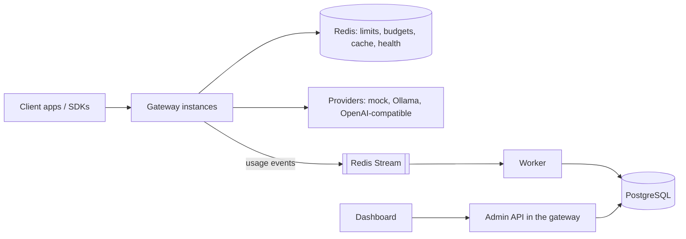

# AI Gateway

**Live demo: <https://ai-gateway-8var.onrender.com/docs>.** It runs on free hosting that sleeps
when idle, so the first request can take about a minute.

A self-hostable, OpenAI-compatible AI gateway. It sits between your apps and model providers and
adds per-project API keys, rate and token limits, budgets, routing with retries and failover,
circuit breakers, an exact-match cache, and a record of every request with its cost. Everything
runs locally with no paid API and no cloud account: a deterministic mock provider stands in for
real models, and Ollama works too.

**Status: MVP (milestones M0-M5).** Architecture decisions are in [docs/adr/](docs/adr/).

- `POST /v1/chat/completions` in OpenAI format, streaming and non-streaming; the official OpenAI
  SDKs work unchanged.
- Limits per key and per project (requests/min, tokens/min, concurrent requests) and monthly
  budgets per project, enforced across any number of gateway instances with Redis Lua scripts.
- Routing per model: priority with fallback, weighted, lowest latency or lowest cost; bounded
  retries with jittered backoff (never after the first streamed byte); circuit breakers with
  health checks. Each attempt is stored with the reason it was made.
- Usage accounting through a Redis Stream into Postgres, exactly once in effect, with a
  dead-letter path; costs from versioned prices.
- A dashboard: overview counters, a request list with routing history, API key management.



## Run it locally

You need Node 22 (`.nvmrc`), pnpm through corepack (`corepack enable`), and Docker with Compose
v2.20+. [Ollama](https://ollama.com) is optional.

```bash
pnpm install
cp .env.example .env
# Set API_KEY_PEPPER in .env to a random secret of 32+ characters:
openssl rand -hex 32
docker compose up -d   # Postgres 16 and Redis 7, on 127.0.0.1 only
pnpm db:seed           # migrations, a demo project, an admin and an API key (printed once)
pnpm dev               # gateway on :8080, worker, dashboard on :5173
```

On Windows, run `pnpm` from PowerShell (pnpm scripts can fail from Git Bash). Without `openssl`,
generate the pepper with a cryptographic random source:

```powershell
$b = New-Object byte[] 32; [Security.Cryptography.RandomNumberGenerator]::Create().GetBytes($b)
-join ($b | ForEach-Object { $_.ToString('x2') })
```

`pnpm db:seed` prints an admin email and password and an API key. Keep them: they are not shown
again (running it again adds a new key and keeps the admin's password).

Send a request with the key:

```bash
export GW_KEY=gw_...   # the key db:seed printed
curl -s http://127.0.0.1:8080/v1/chat/completions \
  -H "authorization: Bearer $GW_KEY" -H 'content-type: application/json' \
  -d '{"model": "mock-1", "messages": [{"role": "user", "content": "Hello"}]}'
```

Add `"stream": true` for server-sent events. Then:

- Open the dashboard at <http://127.0.0.1:5173> and log in with the seeded admin.
- Open the API docs at <http://127.0.0.1:8080/docs>; **Authorize** with the key to try `/v1`.

### The two-minute demo

With the stack running, `pnpm demo` shows a rate limit and a provider failover against your
gateway. It logs in as the seeded admin, creates two temporary keys, and revokes them at the end.

```bash
ADMIN_PASSWORD='<password db:seed printed>' pnpm demo
# PowerShell: $env:ADMIN_PASSWORD='<password>'; pnpm demo
```

1. **Rate limit**: a key limited to 5 requests per minute sends 8; the last 3 get
   `429 rpm_limit_exceeded` with `retry-after`.
2. **Failover**: `mock-failover` routes to `mock-error` (always HTTP 500) and then `mock`. The demo
   prints each request's routing history from the admin API: a retry, the fallback, and, after 5
   failures, the circuit breaker skipping the failing deployment.

`GATEWAY_URL` (default `http://127.0.0.1:8080`) and `ADMIN_EMAIL` (default `admin@example.com`)
point it elsewhere.

### Everything in containers

```bash
docker compose --profile full up -d --build
```

This adds the gateway (:8080), the worker and the dashboard (<http://127.0.0.1:3000>, which proxies
the API under `/api`). Compose reads `API_KEY_PEPPER` from `.env`. For a first admin and key,
either set `BOOTSTRAP_ADMIN_EMAIL`, `BOOTSTRAP_ADMIN_PASSWORD` and `BOOTSTRAP_API_KEY` (from
`pnpm key:generate`) in `.env`, or run `pnpm db:seed` on the host, which reaches the same Postgres.
In Compose the gateway reaches Ollama on the host at `host.docker.internal:11434`.

### Tests

| Command | What it runs |
| --- | --- |
| `pnpm test` | Unit tests; no services needed |
| `pnpm test:int` | Integration tests against Compose Postgres and Redis (`docker compose up -d` first): API contracts, isolation, Lua limits across two instances, routing and breakers, the usage pipeline, the OpenAI SDK |
| `pnpm lint`, `pnpm typecheck`, `pnpm format` | ESLint, `tsc`, Prettier |

CI (GitHub Actions) runs all of them plus the container builds on every push. The SIGTERM
process tests skip on Windows, where signals do not run handlers; they run in CI.

## Using the API

Point any OpenAI client at the gateway:

```ts
import OpenAI from 'openai';

const client = new OpenAI({ baseURL: 'http://127.0.0.1:8080/v1', apiKey: process.env.GW_KEY });
const stream = await client.chat.completions.create({
  model: 'mock-1',
  messages: [{ role: 'user', content: 'Hello' }],
  stream: true,
});
for await (const chunk of stream) process.stdout.write(chunk.choices[0]?.delta.content ?? '');
```

| Endpoint | Meaning |
| --- | --- |
| `POST /v1/chat/completions` | OpenAI chat completions. `stream: true` returns SSE chunks ending with `data: [DONE]`; `stream_options.include_usage` adds a usage chunk. |
| `/admin/...` | Admin API used by the dashboard; see [Admin API](#admin-api). |
| `GET /docs` | Swagger UI; the OpenAPI 3.1 spec is at `/docs/json`. |
| `GET /health` | The process is up. |
| `GET /ready` | 200 when Postgres and Redis answer within `READY_CHECK_TIMEOUT_MS`, else 503 naming the failing check. |

The body accepts OpenAI's text chat parameters (`messages`, `max_tokens` or
`max_completion_tokens`, `temperature`, `top_p`, `stop`, `seed`, penalties, `user`) and rejects
anything else (tools, `response_format`, images, `n > 1`) with a 400 naming the field. Bodies
over 1 MiB get 413. Every response has a server-generated `x-request-id`; the logs for that
request carry it as `requestId`, and each upstream call is logged once with its `attemptId`.

### Errors

Errors use the OpenAI shape `{"error": {"message", "type", "param", "code"}}` and never include
stack traces or a provider's own error text. `x-should-retry` tells OpenAI SDKs whether a retry
can help.

| Status | `code` | When |
| --- | --- | --- |
| 400 | `invalid_request` | The body failed validation. |
| 400 | `request_exceeds_limit` | The request could never fit: more tokens than the TPM limit, or a worst-case cost above the project's per-request cap or whole budget. Lower `max_tokens`. |
| 401 | `invalid_api_key` | Missing, unknown, revoked or expired key. |
| 403 | `model_not_allowed` | The model is outside the project's allow-list. |
| 404 | `model_not_found` | No such model, or none of its deployments is enabled. |
| 429 | `rpm_limit_exceeded`, `tpm_limit_exceeded`, `concurrency_limit_exceeded` | A key or project limit, with `retry-after`. |
| 429 | `budget_exceeded` | The monthly budget is used up; `retry-after` is the start of next month. |
| 429 | `upstream_rate_limited` | The last deployment tried was rate limited by its provider. |
| 502 | `upstream_error`, `upstream_unavailable`, `upstream_invalid_response`, `upstream_auth_failed`, `upstream_model_not_found` | The providers tried failed or are misconfigured (the last failure is reported). |
| 503 | `deployments_unavailable` | Every deployment of the model has an open circuit breaker. |
| 503 | `limits_unavailable` | Redis is unreachable and `LIMITS_FAIL_MODE=closed`; only requests with limits are affected. |
| 504 | `upstream_timeout` | The deployment's timeout passed. |

A failure after a stream has started is sent as a final `{"error": ...}` event and the stream
ends without `[DONE]`.

## Models and routing

Clients send a logical model name. [apps/gateway/config/models.json](apps/gateway/config/models.json)
(or the file in `MODELS_CONFIG_PATH`) maps each name to deployments: a provider, its own model
name, timeouts and an output cap. The file is validated at startup.

| Provider | Talks to | Notes |
| --- | --- | --- |
| `mock` | nothing (in-process) | Deterministic: `latencyMs`, `ttftMs`, `tokensPerSecond`, `completionTokens`, `promptTokens`, `errorRate` with `seed`, `failWith` (`429` or `500`), `retryAfterMs`, `dropAfterTokens`. |
| `ollama` | Ollama's `/api/chat` | `baseUrl` defaults to `OLLAMA_BASE_URL`. |
| `openai-compatible` | any `/v1/chat/completions` API | `apiKeyEnv` names the variable holding the key; without it the deployment is disabled. |

Per deployment, `timeoutMs` bounds a non-streaming call or the wait for a stream's first token,
`streamIdleTimeoutMs` the silence between tokens, and `maxOutputTokens` (4096) is sent upstream
when the client sets no `max_tokens`. A client that disconnects cancels the upstream call.

A model names one deployment, or several with a policy:

```json
"mock-failover": {
  "policy": "priority",
  "targets": [{ "deployment": "mock-error" }, { "deployment": "mock" }]
}
```

| Policy | First choice | Then |
| --- | --- | --- |
| `priority` | the first target | the others in order |
| `weighted` | random, in proportion to `weight` | the rest by weight |
| `lowest_latency` | lowest moving average of time to first byte; unmeasured ones first | slower ones |
| `cost_aware` | lowest worst-case cost at current prices (unpriced counts as free) | costlier ones |

- **Retries** (ADR 011): a timeout, rate limit, 5xx or dropped connection is retried on the same
  deployment (`RETRY_PER_DEPLOYMENT`, 2 tries) after a random backoff below
  `RETRY_BASE_DELAY_MS x 2^n` (capped at `RETRY_MAX_DELAY_MS`), then the next target is tried.
  `RETRY_MAX_ATTEMPTS` (3) caps attempts per request. A 400 is never retried, and nothing is
  retried once a stream has sent its first byte.
- **Circuit breakers** (ADR 012): after `BREAKER_FAILURE_THRESHOLD` (5) consecutive failures a
  deployment is skipped for `BREAKER_OPEN_MS` (30 s). Open deployments are health-checked every
  `HEALTH_CHECK_INTERVAL_MS` with a call that runs no model; a pass lets one trial request through,
  and its success closes the breaker. Breakers are per instance; their state is also published in
  Redis and in `provider_health_events`.
- **Routing history**: each attempt is stored with its policy and reason, e.g.
  `priority 2 of 2; fallback after mock-error failed (server_error)`. See it in the dashboard or at
  `GET /admin/requests/:requestId`.
- **Cache** (ADR 013, off by default): with `CACHE_ENABLED=true`, requests with `temperature: 0`,
  or sent with `x-gateway-cache: on`, are answered from an exact-match cache keyed by project,
  model and request. Projects never share entries. Hits count toward request limits but cost
  nothing, and are recorded with `cacheHit: true`. `x-gateway-cache: off` skips the cache.

The default file has `mock-1` and a mock for every failure mode (`mock-slow`,
`mock-rate-limited`, `mock-error`, `mock-flaky`, `mock-drop`), two routed models (`mock-failover`,
`mock-balanced`), `llama3.2` on Ollama, and `gpt-4o-mini` (enabled only when `OPENAI_API_KEY`
is set).

## Limits and budgets

Limits are set per project (all its keys together) and per API key with the admin API, where
`null` means no limit. Each request's checks run in one Redis Lua script that takes all of them or
none, so they hold across instances (ADR 008).

```bash
curl -s -X PATCH "http://127.0.0.1:8080/admin/projects/$PROJECT_ID" \
  -b "gw_session=$SESSION" -H 'content-type: application/json' \
  -d '{"limits": {"requestsPerMinute": 60, "tokensPerMinute": 100000, "concurrentRequests": 10},
       "budget": {"monthlyLimitMicroUsd": 5000000, "maxRequestCostMicroUsd": 50000}}'
```

| Setting | How it works |
| --- | --- |
| `requestsPerMinute` | Token bucket, refilled evenly over the minute. |
| `tokensPerMinute` | Token bucket: reserves the estimated prompt plus the output cap before the call, then is corrected to the tokens actually used. |
| `concurrentRequests` | Leases that running requests renew; a crashed instance's leases expire after `LIMITS_LEASE_TTL_MS` (30 s). |
| `budget.monthlyLimitMicroUsd` | Per UTC month, in micro-dollars ($1 = 1,000,000). Each request reserves its worst-case cost and is charged its actual cost after (ADR 009). |
| `budget.maxRequestCostMicroUsd` | The most one request may reserve; a costlier request gets a 400. |

Rejections are recorded as `rejected` requests. Spend stays within **budget + requests in flight
x max request cost**: a request costs more than it reserved only when the provider counts more
prompt tokens than the gateway estimated, or its reservation expired while it ran. Postgres keeps
each project's monthly spend; if Redis loses its data (a restart with no persistence), the totals
are rebuilt from Postgres instead of starting from zero. Models with no price cost nothing.

If Redis is unreachable, `LIMITS_FAIL_MODE=closed` (default) answers 503 to requests that have a
limit or budget, and `open` admits them unchecked (ADR 010). Requests with no limits never touch
Redis.

## API keys and the admin API

Keys look like `gw_<keyId>_<secret>` (ADR 006). Only an HMAC-SHA256 of the secret, keyed with
`API_KEY_PEPPER`, is stored, and the full key is shown once. Each instance caches a verified key
for `API_KEY_CACHE_TTL_MS` (30 s); revoking or rotating a key, or changing a project's settings,
tells every instance through Redis pub/sub, and the TTL bounds the delay if that message is lost.
Rotation keeps the old key working for a grace period (default
`API_KEY_ROTATION_GRACE_SECONDS`). A project's `allowedModels` limits the models its keys may call.

### Admin API

`POST /admin/auth/login` sets an HTTP-only, `SameSite=Strict` session cookie that every other admin
route requires (ADR 007). Roles are per project: `viewer` reads, `admin` also manages keys and
settings, `owner` also manages members.

| Route | Role |
| --- | --- |
| `POST /admin/auth/login`, `POST /admin/auth/logout`, `GET /admin/me` | any user |
| `GET /admin/projects`, `POST /admin/projects` (the creator becomes owner) | any user |
| `GET /admin/projects/:projectId` | viewer |
| `PATCH /admin/projects/:projectId` (name, `allowedModels`, `limits`, `budget`) | admin |
| `GET /admin/projects/:projectId/overview` (last 24 h, spend this month) | viewer |
| `GET /admin/projects/:projectId/requests?limit&cursor` (newest first) | viewer |
| `GET /admin/requests/:requestId`: the request, its usage and every attempt with its routing reason | viewer |
| `GET /admin/projects/:projectId/members` | viewer |
| `POST`, `PATCH`, `DELETE /admin/projects/:projectId/members[/:userId]` | owner |
| `GET /admin/projects/:projectId/api-keys` | viewer |
| `POST .../api-keys`, `PATCH .../api-keys/:apiKeyId` (name, `limits`), `.../revoke`, `.../rotate` | admin |
| `GET /admin/projects/:projectId/audit-logs` | admin |

Another project's resources answer 404, exactly like ones that do not exist. Every change writes
an `audit_logs` row in the same transaction. Logins are limited per email and per client IP
(`LOGIN_ATTEMPTS_PER_MINUTE`, `LOGIN_ATTEMPTS_PER_MINUTE_PER_IP`); behind a proxy, set
`TRUST_PROXY` to the number of proxies in front so the client IP is the real one.

## Usage accounting

Each `/v1` request that passes authentication and validation becomes one `request.completed`
event with its status, timings, attempts and tokens, never its prompt or output. The gateway hands
it to a bounded in-memory buffer and returns; a background loop writes it to a Redis Stream. While
Redis is down, events wait in the buffer (`EVENTS_BUFFER_MAX`); past that they are dropped and
counted in the logs.

The worker (ADR 014) reads the stream in a consumer group, writes each batch in one transaction
with `ON CONFLICT DO NOTHING`, and acknowledges only after the commit: a crash re-delivers, and a
re-delivery changes nothing. Entries left by a dead worker are claimed after
`WORKER_CLAIM_IDLE_MS`; an entry delivered more than `WORKER_MAX_DELIVERIES` times goes to a
dead-letter stream and the `failed_events` table. If Redis restarts empty, the worker recreates
its consumer group.

`usage_source` is `reported` (by the provider), `estimated` (by the gateway's tokenizer
approximation, when a stream was cut off or the provider sent no counts) or `missing`. Cost, in
integer micro-dollars, uses the `model_prices` version in effect when the request started
(ADR 016); price rows are immutable, so past costs never move. `pnpm db:seed` adds demo prices for
the mock provider.

Migrations are plain SQL in [db/migrations](db/migrations) (ADR 003), applied at startup under a
Postgres advisory lock (`MIGRATE_ON_START`), or by hand with `pnpm db:migrate`.

## Deploying (Render, or any host without a shell)

The gateway image is the last Dockerfile stage, so a plain `docker build .` builds it. Everything
it needs runs at startup: migrations, and an optional bootstrap that creates a project, an owner
and an API key if they are missing (existing users, passwords and keys are never changed). On a
host with no background workers, run the usage consumer inside the gateway.

| Variable | Purpose | Value |
| --- | --- | --- |
| `DATABASE_URL`, `REDIS_URL` | Postgres and Redis | from your provider |
| `API_KEY_PEPPER` | Secret for API-key hashes (required; changing it invalidates every key) | `openssl rand -hex 32`, or the host's *Generate* |
| `BOOTSTRAP_ADMIN_EMAIL`, `BOOTSTRAP_ADMIN_PASSWORD` | First owner, to log in to `/admin` | your email; 12+ characters |
| `BOOTSTRAP_API_KEY` | First API key | `pnpm key:generate` on your machine |
| `RUN_WORKER_IN_PROCESS` | Run the usage consumer in the gateway | `true` |
| `TRUST_PROXY` | Proxies in front, for the client IP in login limits | how many your host puts in front (0 trusts none) |

A Redis without persistence (Render's free plan) is fine: rate limits restart, budgets are
rebuilt from Postgres, and the usage stream and consumer group are recreated. Events in the
stream at the moment of a restart are lost.

Then open `/docs`, **Authorize** with the key, and call `POST /v1/chat/completions`.

## Configuration

Every setting is an environment variable, validated at startup; invalid config exits with a
message naming each problem. [.env.example](.env.example) lists them all with their defaults.
`pnpm dev` loads `.env`; never commit it.

## Repository layout

```text
apps/gateway     Fastify API: /v1 proxy, providers, routing, limits, cache, /admin API
apps/worker      usage-event consumer (also runs inside the gateway with RUN_WORKER_IN_PROCESS)
apps/dashboard   React + Vite + TanStack Query/Table
packages/shared  config, clock, logger, ids, token estimates, Postgres/Redis clients
db/migrations    numbered plain-SQL migrations
infra/compose    Docker Compose stack (compose.yaml at the root includes it)
scripts          formatting and the demo
docs/adr         architecture decision records
```

## Known limitations

- Budgets can be overspent by at most the requests in flight times the most one can cost; in
  `open` fail mode they are not enforced while Redis is down.
- Circuit breakers are per instance, so instances can briefly disagree about a deployment.
- The cache is exact-match only and off by default; sampled requests are cached only on request.
- No response-quality evaluation: routing weighs latency, cost and failures only.
- Redis Cluster is not supported (one Redis primary is).
- More deferred work is listed in [docs/PLAN-NOTES.md](docs/PLAN-NOTES.md).
