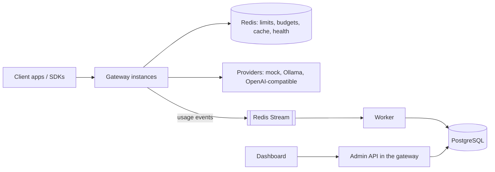

# AI Gateway

**Live demo: <https://ai-gateway-8var.onrender.com/docs>.** It runs on free hosting that sleeps
when idle, so the first request can take about a minute.

A self-hostable, OpenAI-compatible AI gateway. It sits between your apps and model providers and
adds per-project API keys, rate and token limits, budgets, routing with retries and failover,
circuit breakers, an exact-match cache, and a record of every request with its cost. Everything
runs locally with no paid API and no cloud account: a deterministic mock provider stands in for
real models, and Ollama works too.

**Status: MVP (milestones M0-M5), the analytics API (M6), the full dashboard (M7),
observability (M8) and benchmarks (M9).**
Architecture decisions are in [docs/adr/](docs/adr/).

- `POST /v1/chat/completions` in OpenAI format, streaming and non-streaming; the official OpenAI
  SDKs work unchanged.
- Limits per key and per project (requests/min, tokens/min, concurrent requests) and monthly
  budgets per project, enforced across any number of gateway instances with Redis Lua scripts.
- Routing per model: priority with fallback, weighted, lowest latency or lowest cost; bounded
  retries with jittered backoff (never after the first streamed byte); circuit breakers with
  health checks. Each attempt is stored with the reason it was made.
- Usage accounting through a Redis Stream into Postgres, exactly once in effect, with a
  dead-letter path; costs from versioned prices.
- An analytics API over per-minute, hourly and daily rollups: traffic, cost and budgets, model
  comparison, reliability, rejections and pipeline health, for 1 h to 30 days.
- A dashboard on that API: overview, requests with filters and routing history, cost and budgets,
  model comparison, reliability, security, infrastructure, and settings (project, limits and
  budget, members, API keys, deployments and routing). Usable on a phone.
- Prometheus metrics from the gateway and the worker (token-protected `/metrics`), W3C trace IDs
  on every log line from the request to the worker's insert, and a local Prometheus and Grafana
  stack with a provisioned dashboard.



## Run it locally

You need Node 22 (`.nvmrc`), pnpm through corepack (`corepack enable`), and Docker with Compose
v2.20+. [Ollama](https://ollama.com) is optional.

```bash
pnpm install
cp .env.example .env
# Set API_KEY_PEPPER in .env to a random secret of 32+ characters:
openssl rand -hex 32
docker compose up -d   # Postgres 16 and Redis 7, on 127.0.0.1 only
pnpm db:seed           # migrations, a demo project, an admin and an API key (printed once)
pnpm dev               # gateway on :8080, worker, dashboard on :5173
```

On Windows, run `pnpm` from PowerShell (pnpm scripts can fail from Git Bash). Without `openssl`,
generate the pepper with a cryptographic random source:

```powershell
$b = New-Object byte[] 32; [Security.Cryptography.RandomNumberGenerator]::Create().GetBytes($b)
-join ($b | ForEach-Object { $_.ToString('x2') })
```

`pnpm db:seed` prints an admin email and password and an API key. Keep them: they are not shown
again (running it again adds a new key and keeps the admin's password).

Send a request with the key:

```bash
export GW_KEY=gw_...   # the key db:seed printed
curl -s http://127.0.0.1:8080/v1/chat/completions \
  -H "authorization: Bearer $GW_KEY" -H 'content-type: application/json' \
  -d '{"model": "mock-1", "messages": [{"role": "user", "content": "Hello"}]}'
```

Add `"stream": true` for server-sent events. Then:

- Open the dashboard at <http://127.0.0.1:5173> and log in with the seeded admin.
- Open the API docs at <http://127.0.0.1:8080/docs>; **Authorize** with the key to try `/v1`.

### The two-minute demo

With the stack running, `pnpm demo` shows a rate limit and a provider failover against your
gateway. It logs in as the seeded admin, creates two temporary keys, and revokes them at the end.

```bash
ADMIN_PASSWORD='<password db:seed printed>' pnpm demo
# PowerShell: $env:ADMIN_PASSWORD='<password>'; pnpm demo
```

1. **Rate limit**: a key limited to 5 requests per minute sends 8; the last 3 get
   `429 rpm_limit_exceeded` with `retry-after`.
2. **Failover**: `mock-failover` routes to `mock-error` (always HTTP 500) and then `mock`. The demo
   prints each request's routing history from the admin API: a retry, the fallback, and, after 5
   failures, the circuit breaker skipping the failing deployment.

`GATEWAY_URL` (default `http://127.0.0.1:8080`) and `ADMIN_EMAIL` (default `admin@example.com`)
point it elsewhere.

### Everything in containers

```bash
docker compose --profile full up -d --build
```

This adds the gateway (:8080), the worker and the dashboard (<http://127.0.0.1:3000>, which proxies
the API under `/api`). Compose reads `API_KEY_PEPPER` from `.env`. For a first admin and key,
either set `BOOTSTRAP_ADMIN_EMAIL`, `BOOTSTRAP_ADMIN_PASSWORD` and `BOOTSTRAP_API_KEY` (from
`pnpm key:generate`) in `.env`, or run `pnpm db:seed` on the host, which reaches the same Postgres.
In Compose the gateway reaches Ollama on the host at `host.docker.internal:11434`. Add
`--profile observability` for Prometheus and Grafana ([Observability](#observability)).

### Tests

| Command | What it runs |
| --- | --- |
| `pnpm test` | Unit tests; no services needed |
| `pnpm test:int` | Integration tests against Compose Postgres and Redis (`docker compose up -d` first): API contracts, isolation, Lua limits across two instances, routing and breakers, the usage pipeline, the OpenAI SDK |
| `pnpm test:e2e` | The dashboard in Chromium at 375 px, with API answers from fixtures (`pnpm --filter @ai-gateway/dashboard exec playwright install chromium` once) |
| `pnpm check:dashboard-data` | Fails on hand-written numbers in dashboard chart data |
| `pnpm bench:report --check` | Fails when [docs/benchmarks.md](docs/benchmarks.md) differs from what the committed benchmark results generate |
| `pnpm lint`, `pnpm typecheck`, `pnpm format` | ESLint, `tsc`, Prettier |

CI (GitHub Actions) runs all of them plus the container builds on every push. The SIGTERM
process tests skip on Windows, where signals do not run handlers; they run in CI.

## Using the API

Point any OpenAI client at the gateway:

```ts
import OpenAI from 'openai';

const client = new OpenAI({ baseURL: 'http://127.0.0.1:8080/v1', apiKey: process.env.GW_KEY });
const stream = await client.chat.completions.create({
  model: 'mock-1',
  messages: [{ role: 'user', content: 'Hello' }],
  stream: true,
});
for await (const chunk of stream) process.stdout.write(chunk.choices[0]?.delta.content ?? '');
```

| Endpoint | Meaning |
| --- | --- |
| `POST /v1/chat/completions` | OpenAI chat completions. `stream: true` returns SSE chunks ending with `data: [DONE]`; `stream_options.include_usage` adds a usage chunk. |
| `/admin/...` | Admin API used by the dashboard; see [Admin API](#admin-api). |
| `GET /docs` | Swagger UI; the OpenAPI 3.1 spec is at `/docs/json`. |
| `GET /health` | The process is up. |
| `GET /ready` | 200 when Postgres and Redis answer within `READY_CHECK_TIMEOUT_MS`, else 503 naming the failing check. |

The body accepts OpenAI's text chat parameters (`messages`, `max_tokens` or
`max_completion_tokens`, `temperature`, `top_p`, `stop`, `seed`, penalties, `user`) and rejects
anything else (tools, `response_format`, images, `n > 1`) with a 400 naming the field. Bodies
over 1 MiB get 413. Every response has a server-generated `x-request-id`; the logs for that
request carry it as `requestId`, and each upstream call is logged once with its `attemptId`.

### Errors

Errors use the OpenAI shape `{"error": {"message", "type", "param", "code"}}` and never include
stack traces or a provider's own error text. `x-should-retry` tells OpenAI SDKs whether a retry
can help.

| Status | `code` | When |
| --- | --- | --- |
| 400 | `invalid_request` | The body failed validation. |
| 400 | `request_exceeds_limit` | The request could never fit: more tokens than the TPM limit, or a worst-case cost above the project's per-request cap or whole budget. Lower `max_tokens`. |
| 401 | `invalid_api_key` | Missing, unknown, revoked or expired key. |
| 403 | `model_not_allowed` | The model is outside the project's allow-list. |
| 404 | `model_not_found` | No such model, or none of its deployments is enabled. |
| 429 | `rpm_limit_exceeded`, `tpm_limit_exceeded`, `concurrency_limit_exceeded` | A key or project limit, with `retry-after`. |
| 429 | `budget_exceeded` | The monthly budget is used up; `retry-after` is the start of next month. |
| 429 | `upstream_rate_limited` | The last deployment tried was rate limited by its provider. |
| 502 | `upstream_error`, `upstream_unavailable`, `upstream_invalid_response`, `upstream_auth_failed`, `upstream_model_not_found` | The providers tried failed or are misconfigured (the last failure is reported). |
| 503 | `deployments_unavailable` | Every deployment of the model has an open circuit breaker. |
| 503 | `limits_unavailable` | Redis is unreachable and `LIMITS_FAIL_MODE=closed`; only requests with limits are affected. |
| 504 | `upstream_timeout` | The deployment's timeout passed. |

A failure after a stream has started is sent as a final `{"error": ...}` event and the stream
ends without `[DONE]`.

## Models and routing

Clients send a logical model name. [apps/gateway/config/models.json](apps/gateway/config/models.json)
(or the file in `MODELS_CONFIG_PATH`) maps each name to deployments: a provider, its own model
name, timeouts and an output cap. The file is validated at startup.

| Provider | Talks to | Notes |
| --- | --- | --- |
| `mock` | nothing (in-process) | Deterministic: `latencyMs`, `ttftMs`, `tokensPerSecond`, `completionTokens`, `promptTokens`, `errorRate` with `seed`, `failWith` (`429` or `500`), `retryAfterMs`, `dropAfterTokens`. |
| `ollama` | Ollama's `/api/chat` | `baseUrl` defaults to `OLLAMA_BASE_URL`. |
| `openai-compatible` | any `/v1/chat/completions` API | `apiKeyEnv` names the variable holding the key; without it the deployment is disabled. |

Per deployment, `timeoutMs` bounds a non-streaming call or the wait for a stream's first token,
`streamIdleTimeoutMs` the silence between tokens, and `maxOutputTokens` (4096) is sent upstream
when the client sets no `max_tokens`. A client that disconnects cancels the upstream call.

A model names one deployment, or several with a policy:

```json
"mock-failover": {
  "policy": "priority",
  "targets": [{ "deployment": "mock-error" }, { "deployment": "mock" }]
}
```

| Policy | First choice | Then |
| --- | --- | --- |
| `priority` | the first target | the others in order |
| `weighted` | random, in proportion to `weight` | the rest by weight |
| `lowest_latency` | lowest moving average of time to first byte; unmeasured ones first | slower ones |
| `cost_aware` | lowest worst-case cost at current prices (unpriced counts as free) | costlier ones |

- **Retries** (ADR 011): a timeout, rate limit, 5xx or dropped connection is retried on the same
  deployment (`RETRY_PER_DEPLOYMENT`, 2 tries) after a random backoff below
  `RETRY_BASE_DELAY_MS x 2^n` (capped at `RETRY_MAX_DELAY_MS`), then the next target is tried.
  `RETRY_MAX_ATTEMPTS` (3) caps attempts per request. A 400 is never retried, and nothing is
  retried once a stream has sent its first byte.
- **Circuit breakers** (ADR 012): after `BREAKER_FAILURE_THRESHOLD` (5) consecutive failures a
  deployment is skipped for `BREAKER_OPEN_MS` (30 s). Open deployments are health-checked every
  `HEALTH_CHECK_INTERVAL_MS` with a call that runs no model; a pass lets one trial request through,
  and its success closes the breaker. Breakers are per instance; their state is also published in
  Redis and in `provider_health_events`.
- **Routing history**: each attempt is stored with its policy and reason, e.g.
  `priority 2 of 2; fallback after mock-error failed (server_error)`. See it in the dashboard or at
  `GET /admin/requests/:requestId`.
- **Cache** (ADR 013, off by default): with `CACHE_ENABLED=true`, requests with `temperature: 0`,
  or sent with `x-gateway-cache: on`, are answered from an exact-match cache keyed by project,
  model and request. Projects never share entries. Hits count toward request limits but cost
  nothing, and are recorded with `cacheHit: true`. `x-gateway-cache: off` skips the cache.

The default file has these models:

| Model | Served by | Needs |
| --- | --- | --- |
| `mock-1` | the mock | nothing |
| `mock-slow`, `mock-rate-limited`, `mock-error`, `mock-flaky`, `mock-drop` | the mock, one failure mode each | nothing |
| `mock-failover` | `priority`: `mock-error`, then `mock` | nothing |
| `mock-balanced` | `weighted`: `mock` ×3, `mock-flaky` ×1 | nothing |
| `chat-default` | `priority`: Groq `openai/gpt-oss-20b`, then Gemini `gemini-3.5-flash-lite`, then `mock` | nothing; each provider joins once its key is set |
| `gpt-oss-20b` | Groq, `openai/gpt-oss-20b` | `GROQ_API_KEY` |
| `qwen3` | Groq, `qwen/qwen3.8-27b` (a preview model on Groq) | `GROQ_API_KEY` |
| `gemini-3.5-flash-lite` | Google Gemini API (OpenAI-compatible endpoint) | `GEMINI_API_KEY` |
| `gpt-4o-mini` | OpenAI | `OPENAI_API_KEY` |
| `llama3.2` | Ollama, `llama3.2:1b` | a running Ollama |

A deployment whose key variable is empty is disabled at startup (the log says which), and a
model with no enabled deployment answers 404. `chat-default` always answers: with no keys it is
the mock.

The mock also runs as a standalone HTTP server speaking the OpenAI wire format
(`POST /v1/chat/completions` with or without streaming, `GET /v1/models`, `GET /stats` for its
counters), so a gateway reaches it through an `openai-compatible` deployment and a client can
call it directly; the benchmarks use it as their upstream. `pnpm mock:serve` starts it on
`MOCK_HOST:MOCK_PORT` (`127.0.0.1:8090`); `MOCK_SETTINGS` is a JSON object with the same fields
as a deployment's `mock` block, e.g. `MOCK_SETTINGS='{"latencyMs":50,"completionTokens":32}'`.
In a container image it is `node dist/mock-server/main.js`.

### Using real providers

Groq and the Gemini API both speak the OpenAI wire format, so they use the `openai-compatible`
provider; no provider code is specific to them.

1. Create a key: Groq at <https://console.groq.com/keys>, Gemini at
   <https://aistudio.google.com/apikey>.
2. Put it in `.env` (never commit it) as `GROQ_API_KEY=` or `GEMINI_API_KEY=`, then restart
   `pnpm dev`. With Compose, the `full` profile passes both through to the gateway. On a host such
   as Render, set them as environment variables of the gateway service.
3. Call `chat-default` (or `gpt-oss-20b`, `qwen3` or `gemini-3.5-flash-lite` directly):

```bash
curl -s http://127.0.0.1:8080/v1/chat/completions   -H "Authorization: Bearer $GATEWAY_KEY" -H 'content-type: application/json'   -d '{"model":"chat-default","messages":[{"role":"user","content":"Say hi"}]}'
```

If Groq fails or is rate-limited, the request falls back to Gemini, then to the mock; the
request's routing history in the dashboard shows each attempt and why.

`pnpm db:seed` adds prices for these models (from the providers' pricing pages, checked
2026-10-21 and, for `qwen3`, 2026-10-28, with the sources in
[apps/gateway/src/cli/seed-prices.ts](apps/gateway/src/cli/seed-prices.ts)), so their requests
show a cost and count against budgets. A database the seed never ran on (such as the Render demo)
needs the rows inserted; prices are versioned and never edited (ADR 016). Any unique UUID works
as the `id`:

```sql
INSERT INTO model_prices (id, provider, model, input_micro_usd_per_mtok, output_micro_usd_per_mtok, effective_from)
VALUES (gen_random_uuid(), 'openai-compatible', 'openai/gpt-oss-20b', 75000, 300000, '2026-10-21'),
       (gen_random_uuid(), 'openai-compatible', 'qwen/qwen3.8-27b', 800000, 4000000, '2026-10-28'),
       (gen_random_uuid(), 'openai-compatible', 'gemini-3.5-flash-lite', 300000, 2500000, '2026-10-21');
```

Free tiers have low request limits, and Google's pricing page says content sent on the Gemini
free tier is used to improve its products (on the paid tier it is not); check each provider's
terms before sending real data.

`qwen3` is a preview model on Groq: Groq offers previews for evaluation only and may withdraw
them at short notice, so it is not in `chat-default`. It is billed at Groq's listed price.

Not configured, as checked on 2026-10-28: GPT (including OpenAI's open gpt-oss models, beyond the
one on Groq), Grok, DeepSeek and further Qwen models through a free tier. GitHub Models, which
offered them free, was retired on 2026-07-30, and OpenRouter's free (`:free`) models include none
of these families today; all four are paid there. A free one can be added later as another
`openai-compatible` deployment.

## Limits and budgets

Limits are set per project (all its keys together) and per API key with the admin API, where
`null` means no limit. Each request's checks run in one Redis Lua script that takes all of them or
none, so they hold across instances (ADR 008).

```bash
curl -s -X PATCH "http://127.0.0.1:8080/admin/projects/$PROJECT_ID" \
  -b "gw_session=$SESSION" -H 'content-type: application/json' \
  -d '{"limits": {"requestsPerMinute": 60, "tokensPerMinute": 100000, "concurrentRequests": 10},
       "budget": {"monthlyLimitMicroUsd": 5000000, "maxRequestCostMicroUsd": 50000}}'
```

| Setting | How it works |
| --- | --- |
| `requestsPerMinute` | Token bucket, refilled evenly over the minute. |
| `tokensPerMinute` | Token bucket: reserves the estimated prompt plus the output cap before the call, then is corrected to the tokens actually used. |
| `concurrentRequests` | Leases that running requests renew; a crashed instance's leases expire after `LIMITS_LEASE_TTL_MS` (30 s). |
| `budget.monthlyLimitMicroUsd` | Per UTC month, in micro-dollars ($1 = 1,000,000). Each request reserves its worst-case cost and is charged its actual cost after (ADR 009). |
| `budget.maxRequestCostMicroUsd` | The most one request may reserve; a costlier request gets a 400. |

Rejections are recorded as `rejected` requests. Spend stays within **budget + requests in flight
x max request cost**: a request costs more than it reserved only when the provider counts more
prompt tokens than the gateway estimated, or its reservation expired while it ran. Postgres keeps
each project's monthly spend; if Redis loses its data (a restart with no persistence), the totals
are rebuilt from Postgres instead of starting from zero. Models with no price cost nothing.

If Redis is unreachable, `LIMITS_FAIL_MODE=closed` (default) answers 503 to requests that have a
limit or budget, and `open` admits them unchecked (ADR 010). Requests with no limits never touch
Redis.

## API keys and the admin API

Keys look like `gw_<keyId>_<secret>` (ADR 006). Only an HMAC-SHA256 of the secret, keyed with
`API_KEY_PEPPER`, is stored, and the full key is shown once. Each instance caches a verified key
for `API_KEY_CACHE_TTL_MS` (30 s); revoking or rotating a key, or changing a project's settings,
tells every instance through Redis pub/sub, and the TTL bounds the delay if that message is lost.
Rotation keeps the old key working for a grace period (default
`API_KEY_ROTATION_GRACE_SECONDS`). A project's `allowedModels` limits the models its keys may call.

### Admin API

`POST /admin/auth/login` sets an HTTP-only, `SameSite=Strict` session cookie that every other admin
route requires (ADR 007). Roles are per project: `viewer` reads, `admin` also manages keys and
settings, `owner` also manages members.

| Route | Role |
| --- | --- |
| `POST /admin/auth/login`, `POST /admin/auth/logout`, `GET /admin/me` | any user |
| `GET /admin/projects`, `POST /admin/projects` (the creator becomes owner) | any user |
| `GET /admin/projects/:projectId` | viewer |
| `PATCH /admin/projects/:projectId` (name, `allowedModels`, `limits`, `budget`) | admin |
| `GET /admin/analytics/...` (see [Analytics](#analytics)) | viewer |
| `GET /admin/requests/:requestId`: the request, its usage and every attempt with its routing reason | viewer |
| `GET /admin/projects/:projectId/members` | viewer |
| `POST`, `PATCH`, `DELETE /admin/projects/:projectId/members[/:userId]` | owner |
| `GET /admin/projects/:projectId/api-keys` | viewer |
| `POST .../api-keys`, `PATCH .../api-keys/:apiKeyId` (name, `limits`), `.../revoke`, `.../rotate` | admin |
| `GET /admin/projects/:projectId/audit-logs` | admin |

Another project's resources answer 404, exactly like ones that do not exist. Every change writes
an `audit_logs` row in the same transaction. Logins are limited per email and per client IP
(`LOGIN_ATTEMPTS_PER_MINUTE`, `LOGIN_ATTEMPTS_PER_MINUTE_PER_IP`); behind a proxy, set
`TRUST_PROXY` to the number of proxies in front so the client IP is the real one.

## Dashboard

Eight pages, all read from the admin and analytics APIs; nothing is computed or filled in by the
dashboard, and a page with no data says so. The top bar picks the project and the time range
(1 h, 24 h, 7 d, 30 d); pages live in the URL hash (`#cost`, `#settings/keys`), so links and
reloads keep them. Dark is the default theme, with a light one in the top bar.

| Page | Shows |
| --- | --- |
| Overview | KPI cards (requests, error rate, p95 latency, cost, cache hits) with sparklines, requests by outcome over time, recent requests, spend this month against the budget, gateway readiness |
| Requests | Filters (status, key, model, provider), a dense paginated list with latency bars, and a side panel with each request's attempt timings and routing history |
| Cost | KPI cards (spend, cost per request, tokens, projected month or "not enough data"), cost per interval, spend by model as shares, breakdowns by project, key, provider and model with each row's share, budgets as meters |
| Models | p50/p95 latency bars, a table of latency, TTFT, tokens per second, cost, failure and fallback rates (not answer quality), every deployment with its breaker state |
| Reliability | KPI cards for failures, retries, fallbacks and attempts; their trend; errors by code; each deployment's numbers; breaker states per instance and their changes |
| Security | Rejections by kind (limits, budget, model policy), over time, by reason and by key with shares |
| Infrastructure | Worker lag, pending events, dead letters and dependency checks, the pipeline in detail, and the answering instance's process readings |
| Settings | Tabs: Project (name, ID, allowed models), Limits and budget (each limit with the busiest minute of the last hour as a meter, the month's spend against the budget), Members, API keys, Routing (read-only, from the models file) |

Some things are shown as "not measured" or "not tracked" because the gateway does not record
them: change against a previous period, deployment uptime, in-flight requests against the
concurrency limit, and when a key was last used. Each has a row in
[docs/PLAN-NOTES.md](docs/PLAN-NOTES.md). Models come from the models file, so there is no
"add model" button. The design system (tokens, shell, shared components) is ADR 020.

Viewers see every page but no control that changes anything; admins also manage keys, limits
and project settings, and owners also manage members. The API enforces the same roles.

## Analytics

Read-only endpoints for the dashboard, one per section (ADR 015). Each takes `range` (`1h`,
`24h`, `7d` or `30d`; anything else is a 400 listing them) and the filters `projectId`,
`apiKeyId`, `provider`, `model` and `status`. Without `projectId` they cover every project the
caller belongs to; another project's ID is a 404.

| Route | What it returns |
| --- | --- |
| `GET /admin/analytics/overview` | Counts by status, tokens, cost, latency and TTFT percentiles, a request-rate series, spend this month |
| `GET /admin/analytics/requests?limit&cursor` | Requests in the range, newest first, keyset-paginated |
| `GET /admin/analytics/models` | Per model and deployment: latency, TTFT, output tokens per second, cost, failure and fallback rates |
| `GET /admin/analytics/cost` | Spend by provider, model, project and key; a cost series; budgets with alerts at 80% and 100%; a monthly projection |
| `GET /admin/analytics/reliability` | Errors by code, retries, fallbacks per deployment, breaker states and changes |
| `GET /admin/analytics/security` | Rejections by reason (rate, token, concurrency, budget, policy) and by key |
| `GET /admin/analytics/infra` | Usage stream length, unread and pending events, dead letters, Postgres and Redis round trips, measured now |

The worker keeps rollups per minute, hour and day in the same transaction as the request rows, so
totals always match the stored requests and a re-delivered event changes nothing. `1h` and `24h`
read minute rows, `7d` hourly rows and `30d` daily rows (UTC); series have 60, 96, 168 and 30
points. Percentiles come from latency histograms (10 ms to 120 s) and are approximate. The
projection is null, with a reason, until there are 7 full days of data. Retention:
`ROLLUP_RETENTION_MINUTE_HOURS` (48), `ROLLUP_RETENTION_HOUR_DAYS` (35), `ROLLUP_RETENTION_DAY_DAYS`
(400).

Speed and cost comparisons say nothing about answer quality. Requests with an invalid API key are
refused before a project is known, so they are not counted per project.

## Usage accounting

Each `/v1` request that passes authentication and validation becomes one `request.completed`
event with its status, timings, attempts and tokens, never its prompt or output. The gateway hands
it to a bounded in-memory buffer and returns; a background loop writes it to a Redis Stream. While
Redis is down, events wait in the buffer (`EVENTS_BUFFER_MAX`); past that they are dropped and
counted in the logs.

The worker (ADR 014) reads the stream in a consumer group, writes each batch in one transaction
with `ON CONFLICT DO NOTHING`, and acknowledges only after the commit: a crash re-delivers, and a
re-delivery changes nothing. Entries left by a dead worker are claimed after
`WORKER_CLAIM_IDLE_MS`; an entry delivered more than `WORKER_MAX_DELIVERIES` times goes to a
dead-letter stream and the `failed_events` table. If Redis restarts empty, the worker recreates
its consumer group.

`usage_source` is `reported` (by the provider), `estimated` (by the gateway's tokenizer
approximation, when a stream was cut off or the provider sent no counts) or `missing`. Cost, in
integer micro-dollars, uses the `model_prices` version in effect when the request started
(ADR 016); price rows are immutable, so past costs never move. `pnpm db:seed` adds demo prices for
the mock provider.

Migrations are plain SQL in [db/migrations](db/migrations) (ADR 003), applied at startup under a
Postgres advisory lock (`MIGRATE_ON_START`), or by hand with `pnpm db:migrate`.

## Observability

Operational metrics are separate from the analytics above (ADR 017): Prometheus metrics from
each process, and trace IDs in the JSON logs.

**Local Prometheus and Grafana.** Both bind to 127.0.0.1. Run them only while you need them:

```bash
docker compose --profile full --profile observability up -d --build
# Grafana: http://127.0.0.1:3001 (anonymous, read-only; opens the "AI Gateway" dashboard)
# Prometheus: http://127.0.0.1:9090/targets (gateway and worker should be up)
docker compose --profile full --profile observability stop prometheus grafana
```

Prometheus scrapes the gateway's and worker's private metrics ports on the Compose network,
which are not published to the host, so no token is involved. Grafana's datasource and
dashboard are provisioned from [infra/compose/observability/](infra/compose/observability/). The
dashboard shows traffic, latency p50/p95, 5xx and failed attempts, rejections, retries and
fallbacks, breakers, TTFT, stream lag and pending, the dead-letter stream, buffered and dropped
events, cache hit ratio, estimate error, batch times and memory. History is kept for one day.

**Scraping a gateway.** `GET /metrics` on the gateway's port exists only when `METRICS_TOKEN` is
set (32+ characters), and needs `Authorization: Bearer <token>`. A missing or wrong token gets
401; with no token set, the route is a 404. `METRICS_PORT` adds a separate listener on
`METRICS_HOST` (default 127.0.0.1). The worker always serves its own on `WORKER_METRICS_PORT`
(default 9465). Both need the token only if one is set.

```bash
curl -H "Authorization: Bearer $METRICS_TOKEN" http://127.0.0.1:8080/metrics
```

| Metric | Labels | What it counts |
| --- | --- | --- |
| `gateway_http_request_duration_seconds` | method, route, status_code | HTTP requests until the response ended; `_count` is the request count |
| `gateway_upstream_attempts_total` | provider, deployment, model, outcome | Provider attempts; outcome is `success` or the error kind |
| `gateway_retries_total` / `gateway_fallbacks_total` | deployment / model | Retries on the same deployment; moves to another deployment |
| `gateway_circuit_breaker_state` / `_transitions_total` | deployment, state / to | 1 for each breaker's current state on this instance; state changes |
| `gateway_cache_lookups_total` | result | Response-cache hits and misses |
| `gateway_admission_rejections_total` | reason | `rpm`, `tpm`, `concurrency`, `budget`, `request_too_large`, `limits_unavailable` |
| `gateway_ttft_seconds` | deployment | Streams: arrival to first token sent |
| `gateway_output_tokens_per_second` | deployment, stream | Reported completion tokens per second of generation |
| `gateway_prompt_token_estimate_error_ratio` | deployment | (estimated − reported) / reported prompt tokens |
| `gateway_usage_events_published_total`, `_dropped_total`, `_buffered` | — | Usage events written, lost to a full buffer, waiting |
| `gateway_pg_pool_clients` | state | Postgres pool: total, idle, waiting |
| `gateway_dependency_up`, `gateway_dependency_latency_seconds` | dependency | Postgres and Redis round trip at scrape time |
| `worker_events_consumed_total`, `_dead_lettered_total`, `_reclaimed_total` | — | Usage events stored, moved to the DLQ, claimed from a dead consumer |
| `worker_consumer_errors_total` | — | Consumer loop failures (it backs off and retries) |
| `worker_batch_duration_seconds`, `worker_rollup_duration_seconds`, `worker_prune_duration_seconds` | — | Insert transaction, rollup statement, retention pass |
| `worker_rollup_rows_pruned_total` | table | Expired rollup rows deleted |
| `usage_stream_lag`, `_pending`, `_oldest_pending_age_seconds`, `_length`, `_consumers`, `usage_dlq_length`, `usage_stream_up` | — | Stream state read from Redis by both processes, so lag stays visible while the worker is down (take the `max`) |

Every process also exports prom-client's default `process_*` and `nodejs_*` metrics. Labels
never carry request, key or project IDs or anything a client sent; values outside the
configuration are labelled `other`.

**Following a request.** The gateway accepts a W3C `traceparent` header (or starts a trace),
returns `traceparent` and `x-request-id`, and sends each provider attempt its own child span as
`traceparent`. Each request log line has `requestId`, `traceId` and `spanId`, and attempt lines
add `attemptSpanId`. The worker's `usage event stored` line has the same `traceId`, with the
request's span as `parentSpanId`. Searching the logs for one `traceId` gives the whole path. There
is no trace store or tracing SDK (ADR 017).

The dashboard's Infrastructure page shows the pipeline state, dependency round trips and the
answering gateway instance's own measurements, from the admin API. History is in Prometheus.

## Benchmarks

[docs/benchmarks.md](docs/benchmarks.md) has the gateway's added latency, time to first token and
throughput, and three correctness checks under load: rate limits across two instances, usage
accounting through a worker crash (each request stored once), and the cache hit ratio for a
repeated temperature-0 workload. Every number in it is generated from k6 output committed in
[bench/results/](bench/results/), with the machine, configuration, durations and limitations of
that run (ADR 019). They are cloud VM numbers for that setup, not measurements of the Render demo,
which is never load-tested.

```bash
pnpm bench          # build the images, start bench/compose.yaml, run every scenario, remove it
pnpm bench:report   # regenerate docs/benchmarks.md from the newest run in bench/results/
```

Only Docker is needed: k6 runs from the pinned `grafana/k6` image on the bench stack's network
(Postgres, Redis, the HTTP mock provider, two gateway instances, one worker; no published ports).
`pnpm bench` takes several minutes and removes the stack and its volumes when it ends; commit the
new `bench/results/<run>/` together with the regenerated report.

| Scenario (`bench/k6/`) | What it measures |
| --- | --- |
| `overhead.js` | Closed-loop VUs (`BENCH_VUS`, default `10,50,100`) sending the same request straight to the mock and through one gateway, streaming and not: p50/p95/p99 latency, TTFT, requests/s |
| `ratelimit.js` | One key with an RPM limit, traffic alternating between both instances: admitted requests against the token bucket's ceiling |
| `accounting.js` | Load across both instances while Postgres is paused and the worker is killed and restarted: requests sent against rows stored, distinct request IDs and rollup counts |
| `cache.js` | A fixed set of temperature-0 prompts repeated across both instances: hit ratio against the best possible, and calls that reached the mock |

## Deploying (Render, or any host without a shell)

The gateway image is the last Dockerfile stage, so a plain `docker build .` builds it. Everything
it needs runs at startup: migrations, and an optional bootstrap that creates a project, an owner
and an API key if they are missing (existing users, passwords and keys are never changed). On a
host with no background workers, run the usage consumer inside the gateway.

| Variable | Purpose | Value |
| --- | --- | --- |
| `DATABASE_URL`, `REDIS_URL` | Postgres and Redis | from your provider |
| `API_KEY_PEPPER` | Secret for API-key hashes (required; changing it invalidates every key) | `openssl rand -hex 32`, or the host's *Generate* |
| `BOOTSTRAP_ADMIN_EMAIL`, `BOOTSTRAP_ADMIN_PASSWORD` | First owner, to log in to `/admin` | your email; 12+ characters |
| `BOOTSTRAP_API_KEY` | First API key | `pnpm key:generate` on your machine |
| `RUN_WORKER_IN_PROCESS` | Run the usage consumer in the gateway | `true` |
| `TRUST_PROXY` | Proxies in front, for the client IP in login limits | how many your host puts in front (0 trusts none) |
| `METRICS_TOKEN` | Bearer token for `GET /metrics`; unset, the route does not exist | 32+ random characters, or the host's *Generate* |

A Redis without persistence (Render's free plan) is fine: rate limits restart, budgets are
rebuilt from Postgres, and the usage stream and consumer group are recreated. Events in the
stream at the moment of a restart are lost.

Then open `/docs`, **Authorize** with the key, and call `POST /v1/chat/completions`.

## Configuration

Every setting is an environment variable, validated at startup; invalid config exits with a
message naming each problem. [.env.example](.env.example) lists them all with their defaults.
`pnpm dev` loads `.env`; never commit it.

## Repository layout

```text
apps/gateway     Fastify API: /v1 proxy, providers, routing, limits, cache, /admin API
apps/worker      usage-event consumer (also runs inside the gateway with RUN_WORKER_IN_PROCESS)
apps/dashboard   React + Vite + TanStack Query/Table + Recharts; e2e/ holds browser checks
packages/shared  config, clock, logger, ids, trace context, token estimates, Postgres/Redis
                 clients, metrics registry and listener
db/migrations    numbered plain-SQL migrations
infra/compose    Docker Compose stack (compose.yaml at the root includes it); observability/
                 holds the Prometheus config and Grafana provisioning
scripts          formatting and the demo
bench            k6 scenarios, the bench Compose stack, `pnpm bench` and the report generator;
                 results/ holds the committed runs
docs/adr         architecture decision records
docs/ROADMAP.md  remaining milestones, with scope and acceptance checks
```

## Known limitations

- Budgets can be overspent by at most the requests in flight times the most one can cost; in
  `open` fail mode they are not enforced while Redis is down.
- Circuit breakers are per instance, so instances can briefly disagree about a deployment.
- The cache is exact-match only and off by default; sampled requests are cached only on request.
- No response-quality evaluation: routing weighs latency, cost and failures only.
- Redis Cluster is not supported (one Redis primary is).
- Analytics percentiles are approximate (histogram buckets), and days are UTC days.
- Metrics are per process: Prometheus must scrape every gateway instance. Traces exist only as
  IDs in the logs; there is no trace store.
- More deferred work is listed in [docs/PLAN-NOTES.md](docs/PLAN-NOTES.md).
