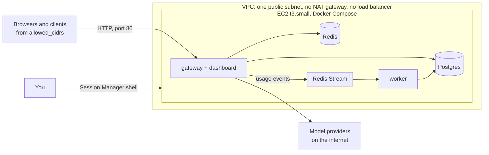
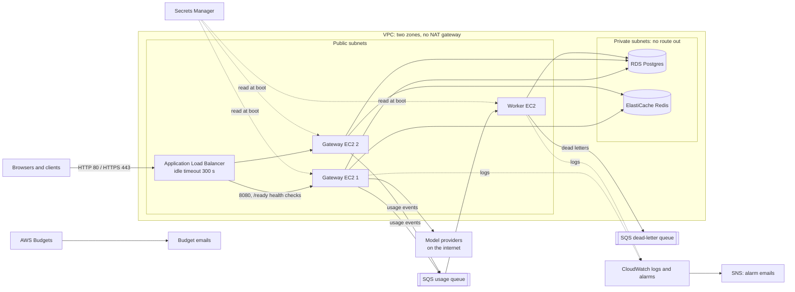

# Deploying to AWS

> **Status: written and tested, never applied.** The Terraform in
> [infra/terraform/](../infra/terraform/) has been formatted, validated and tested against a
> mocked AWS provider (`terraform test`, in CI), but nobody has run `terraform apply` on a real
> account yet. The deploy, check and cleanup steps below are instructions for whoever does it
> someday, and **none of them has been done**. Expect to fix small things on the first real run,
> the instances' first-boot scripts above all. Decisions and their reasons:
> [ADR 022](adr/022-aws-deployment-layout.md) (layout) and [ADR 023](adr/023-sqs-event-bus.md)
> (the SQS event bus).

There are two setups. Pick one; they are independent.

| | demo | full |
| --- | --- | --- |
| What runs where | One EC2 instance runs everything with Docker Compose | Two gateway instances behind a load balancer, one worker instance, managed Postgres and Redis |
| Usage events | Redis Stream on the instance | SQS queue with a dead-letter queue |
| Load balancer | none (the instance's port 80) | Application Load Balancer, optional HTTPS |
| Data | Postgres and Redis containers on the instance's disk | RDS Postgres, ElastiCache Redis |
| Secrets | generated on the instance at first boot | Secrets Manager |
| Logs and alarms | `docker compose logs` on the instance | CloudWatch logs, alarms, AWS Budgets alert |
| Approximate cost | about **$20 a month** ($0.67 a day) | about **$113 a month** ($3.70 a day) |
| Good for | showing the gateway on a public URL | showing limits held across two machines, managed services, failover of instances |

## Architecture

### demo



### full



## What each resource does

### Shared (both setups)

| Resource | Purpose |
| --- | --- |
| VPC, internet gateway, public route table | The network. Public subnets route to the internet through the internet gateway. |
| Default security group (emptied) | AWS creates one per VPC that lets members talk freely; Terraform removes its rules so nothing can use it by accident. |
| IAM role and instance profile per instance kind | Lets the instance use Session Manager (shell access with no SSH key or open port) and, on full, exactly the queue, secrets and log group it needs. |
| EC2 instances (Amazon Linux 2023, x86_64) | Run the containers. IMDSv2 only, encrypted gp3 root volumes. On first boot each installs Docker, Docker Compose and Buildx (pinned versions, checked against their SHA-256 sums), adds a swap file, clones the repository at `git_ref` (default: the `m10-done` tag) and builds the images. |

### demo only

| Resource | Purpose |
| --- | --- |
| One public subnet | Where the instance lives. |
| Security group | Port 80 from `allowed_cidrs` only (no default: you choose who can reach a plain-HTTP demo). No SSH, no database ports. |
| The instance | Runs `docker compose --profile full` with [infra/compose/aws-demo.yml](../infra/compose/aws-demo.yml): gateway on port 80, worker, Postgres, Redis, all restarting with the machine. Generates the API key pepper and the first admin password into a root-only `.env` that never leaves the instance. |

### full only

| Resource | Purpose |
| --- | --- |
| Two public and two private subnets | Instances and the load balancer in the public ones; RDS and ElastiCache in the private ones, whose route table has no route out. |
| Security groups | Clients reach only the load balancer (80, and 443 with a certificate); the load balancer reaches only the gateways on 8080; Postgres takes the gateways and the worker; Redis takes the gateways only; the worker takes nothing. |
| Application Load Balancer, target group, listeners | Spreads requests over the gateways. Idle timeout 300 s so long SSE streams are not cut; health checks on `/ready`; 30 s deregistration delay, longer than the gateway's 10 s drain; drops invalid headers. With `certificate_arn`, HTTP redirects to HTTPS (TLS 1.3/1.2 policy) and the session cookie becomes HTTPS-only. |
| Gateway instances (2, `gateway_count`) | Run the gateway image with `EVENT_BUS=sqs`, `TRUST_PROXY=1`, TLS to RDS with the server certificate verified, and TLS plus a token to Redis. Logs go to CloudWatch through Docker's awslogs driver. |
| Worker instance | Runs the worker image: long-polls SQS, stores usage in Postgres, dead-letters what it cannot store. Needs no Redis. |
| RDS Postgres (`db.t4g.micro`, 20 GB gp3) | The record: requests, usage, costs, users and keys. Private, encrypted, TLS enforced. RDS creates the password and keeps it in Secrets Manager, so it is never in Terraform's state. One day of automated backups by default. |
| ElastiCache Redis (`cache.t4g.micro`, one node) | Limits, budget totals, the cache, breaker views. Private, encrypted at rest and in transit, with an auth token. |
| SQS usage queue and dead-letter queue | Usage events from the gateways to the worker (ADR 023). Encrypted. The worker moves an event it cannot store to the DLQ after 5 deliveries; the redrive policy (10 receives) is a backstop. Dead letters are kept 14 days. |
| Secrets Manager secret (app) | API key pepper, first admin password, Redis token and optional Groq/Gemini keys, generated by Terraform. Gateways read it at boot. |
| CloudWatch log groups | Gateway and worker logs, kept 14 days. |
| CloudWatch alarms and SNS topic | Gateway 5xx, load balancer 5xx, unhealthy gateways, dead letters, worker backlog (oldest event over 10 minutes), Postgres CPU and storage, Redis memory, and a status-check alarm per instance; emailed to `alarm_email` when given. |
| AWS Budgets budget | Account-wide monthly budget (`monthly_budget_usd`, default $150): an email at 80 % of actual spend and when the forecast passes 100 %. |

## Cost

Approximate monthly cost in **us-east-1**, on-demand list prices checked on 2026-10-31, for a
month of 730 hours running all the time with light demo traffic. Prices change and differ by
region; Free Tier credits or allowances, taxes and support plans are left out. Check the
[AWS Pricing Calculator](https://calculator.aws/) before you apply.

### demo

| Item | Unit price | Month |
| --- | --- | --- |
| EC2 `t3.small`, 1 instance | [$0.0208 an hour](https://aws.amazon.com/ec2/pricing/on-demand/) | $15.18 |
| EBS gp3, 20 GB | [$0.08 per GB-month](https://aws.amazon.com/ebs/pricing/) | $1.60 |
| Public IPv4 address, 1 | [$0.005 an hour](https://aws.amazon.com/vpc/pricing/) | $3.65 |
| Data transfer out | [first 100 GB a month free](https://aws.amazon.com/ec2/pricing/on-demand/#Data_Transfer) | $0 |
| **Total** | | **about $20.43 a month, $0.67 a day** |

### full

| Item | Unit price | Month |
| --- | --- | --- |
| EC2 `t3.small`, 3 instances (2 gateways, 1 worker) | [$0.0208 an hour each](https://aws.amazon.com/ec2/pricing/on-demand/) | $45.55 |
| EBS gp3, 3 x 16 GB | [$0.08 per GB-month](https://aws.amazon.com/ebs/pricing/) | $3.84 |
| Public IPv4 addresses, 5 (3 instances, 2 load balancer nodes) | [$0.005 an hour each](https://aws.amazon.com/vpc/pricing/) | $18.25 |
| Application Load Balancer | [$0.0225 an hour, plus $0.008 per LCU-hour](https://aws.amazon.com/elasticloadbalancing/pricing/) | $16.43 + about $2 |
| RDS Postgres `db.t4g.micro`, Single-AZ | [$0.016 an hour](https://aws.amazon.com/rds/postgresql/pricing/) | $11.68 |
| RDS storage, 20 GB gp3 | [$0.115 per GB-month](https://aws.amazon.com/rds/postgresql/pricing/) | $2.30 |
| ElastiCache `cache.t4g.micro`, 1 node | [$0.016 an hour](https://aws.amazon.com/elasticache/pricing/) | $11.68 |
| Secrets Manager, 2 secrets (app, RDS-managed) | [$0.40 per secret-month](https://aws.amazon.com/secrets-manager/pricing/) | $0.80 |
| SQS | [first million requests a month free](https://aws.amazon.com/sqs/pricing/); the worker's 20 s long polls make about 130,000 | $0 |
| CloudWatch: 11 alarms, a little log data | [10 alarms and 5 GB of logs free](https://aws.amazon.com/cloudwatch/pricing/), then $0.10 an alarm | $0.10 |
| SNS alarm emails | [first 1,000 emails free](https://aws.amazon.com/sns/pricing/) | $0 |
| AWS Budgets (no actions) | [free](https://aws.amazon.com/aws-cost-management/aws-budgets/pricing/) | $0 |
| Data transfer out | [first 100 GB a month free](https://aws.amazon.com/ec2/pricing/on-demand/#Data_Transfer) | $0 |
| **Total** | | **about $113 a month, $3.70 a day** |

Most of the full setup's bill is fixed: it is the same with no traffic. Turning `db_multi_az` on
adds another $11.68 plus storage. The default `monthly_budget_usd` ($150) sits above the full
setup's expected cost so the alert means something unexpected is running.

### Avoid NAT gateways

> **Warning.** A NAT gateway costs [$0.045 an hour](https://aws.amazon.com/vpc/pricing/) (about
> $32.85 a month) **per availability zone**, plus $0.045 for every GB it processes, whether or not
> anything uses it. The usual "instances in private subnets behind NAT" layout would add about
> $66 a month to the full setup (two zones) before any traffic, more than half its cost, and more
> than three times the demo. Neither setup creates one, and CI fails if one appears
> (`infra/terraform/scripts/check.mjs`). Instead, instances that need the internet sit in public
> subnets with public addresses, and their security groups admit only the load balancer.
> VPC interface endpoints (about $7.30 a month each per zone) are not used either.
> If you add a NAT gateway yourself, delete it the moment you are done.

## Deploy (not done yet)

> **None of the steps in this section has been carried out.** They describe what to do, on an
> account you control and with spending you accept.

### Before you start

1. An AWS account you can spend money in, ideally a sandbox account, with an IAM role or user
   allowed to manage EC2, VPC, Elastic Load Balancing, RDS, ElastiCache, SQS, Secrets Manager,
   CloudWatch, CloudWatch Logs, SNS, IAM roles and instance profiles, Budgets, and to read SSM
   public parameters. Use short-lived credentials (IAM Identity Center or `aws sso login`), not
   long-lived keys.
2. Terraform 1.16 or later and the AWS CLI v2 (for Session Manager, also the
   [Session Manager plugin](https://docs.aws.amazon.com/systems-manager/latest/userguide/session-manager-working-with-install-plugin.html)).
3. Push the code you want to run to the repository and tag it, or use the `m10-done` tag: the
   instances clone `repository_url` at `git_ref` on first boot.
4. Keep Terraform state somewhere safe. The full setup's state holds generated secrets (the app
   secret and the Redis token). For anything beyond a throwaway test, add a backend before
   `init`, for example an S3 bucket with encryption and versioning:

   ```hcl
   # infra/terraform/full/backend.tf (not committed)
   terraform {
     backend "s3" {
       bucket       = "my-terraform-state-bucket"
       key          = "ai-gateway/full.tfstate"
       region       = "us-east-1"
       encrypt      = true
       use_lockfile = true
     }
   }
   ```

### demo

```sh
cd infra/terraform/demo
terraform init
terraform plan -out demo.tfplan \
  -var 'admin_email=you@example.com' \
  -var 'allowed_cidrs=["203.0.113.4/32"]'   # your IP; ["0.0.0.0/0"] opens it to everyone
terraform apply demo.tfplan
terraform output
```

First boot builds the images, which takes several minutes on a `t3.small`. Then:

```sh
curl "$(terraform output -raw url)/ready"                   # {"status":"ready",...}
$(terraform output -raw session_command)                    # a shell on the instance
sudo grep BOOTSTRAP_ADMIN_PASSWORD /opt/ai-gateway/.env      # in that shell
sudo tail -f /var/log/ai-gateway-setup.log                   # if it is not ready yet
```

Open `dashboard_url`, log in as `admin_email` with that password, and use the Playground, or
create an API key in Settings and call `$(terraform output -raw url)/v1/chat/completions` with
model `mock-1`. The demo serves plain HTTP: do not reuse a real password, and do not put real
provider keys on it.

### full

```sh
cd infra/terraform/full
terraform init
terraform plan -out full.tfplan \
  -var 'admin_email=you@example.com' \
  -var 'budget_email=you@example.com' \
  -var 'alarm_email=you@example.com'
  # optional: -var 'certificate_arn=arn:aws:acm:...' for HTTPS on your own domain
  # optional: -var 'groq_api_key=...' (kept in Secrets Manager and in the state)
terraform apply full.tfplan
terraform output
```

Confirm the SNS subscription email so alarms reach you. RDS and ElastiCache take several minutes
to create; the instances then build their images. Then:

```sh
URL=$(terraform output -raw url)
curl "$URL/ready"
aws secretsmanager get-secret-value --secret-id "$(terraform output -raw admin_password_secret_arn)" \
  --query SecretString --output text | jq -r .bootstrap_admin_password
```

Log in at `dashboard_url`. Gateway and worker logs are in the CloudWatch log groups named by
`terraform output log_groups`.

### Checks to run once it is up (not done yet)

These are the M10 acceptance checks that need a real account:

1. **Smoke test:** `/ready` answers 200 through the load balancer, a `mock-1` chat completion
   streams back, the request appears on the dashboard's Requests page (it went through SQS and
   the worker), and the Infrastructure page shows `Queue length` with the transport `sqs`.
2. **Limits across the two gateways:** create an API key with `requestsPerMinute: 10` in
   Settings, then send 40 requests in parallel through the load balancer, which spreads them over
   both instances. About 10 should answer 200 and the rest 429, as in the local two-instance test
   (`apps/gateway/test/limits-acceptance.test.ts`):

   ```sh
   seq 40 | xargs -P 20 -I{} curl -s -o /dev/null -w '%{http_code}\n' "$URL/v1/chat/completions" \
     -H "authorization: Bearer $KEY" -H 'content-type: application/json' \
     -d '{"model":"mock-1","messages":[{"role":"user","content":"hi"}]}' | sort | uniq -c
   ```

3. **Client IP behind the load balancer:** failed logins from your machine are limited per IP
   (`LOGIN_ATTEMPTS_PER_MINUTE_PER_IP`), which shows `TRUST_PROXY=1` picks your address, not the
   load balancer's.
4. **Cleanup:** the next section, then the billing console a day later.

## Clean up: `terraform destroy` (not done yet)

Everything both setups create is removed by `terraform destroy`. Defaults are chosen so nothing
blocks it or survives it: no deletion protection on RDS or the load balancer, no final database
snapshot, volumes deleted with their instances.

```sh
cd infra/terraform/full    # or demo
terraform destroy \
  -var 'admin_email=you@example.com' -var 'budget_email=you@example.com'   # full
  # demo: -var 'admin_email=you@example.com' -var 'allowed_cidrs=["203.0.113.4/32"]'
```

Then check, in the region you used:

1. **EC2:** no instances (terminated ones vanish after an hour), no volumes, no Elastic IPs, no
   load balancers or target groups.
2. **VPC:** no NAT gateways, and the `ai-gateway-*` VPC is gone.
3. **RDS:** no instances and no snapshots. If you set `db_final_snapshot = true`, the final
   snapshot stays and bills for storage until you delete it.
4. **ElastiCache, SQS, CloudWatch** (log groups and alarms), **SNS**: nothing named
   `ai-gateway-full-*`.
5. **Secrets Manager:** the app secret shows as scheduled for deletion (7-day recovery window).
   The RDS-managed secret is deleted with the database.
6. **AWS Budgets:** the budget is removed by `destroy`.
7. **Billing:** a day later, Cost Explorer shows no new charges for the services above. The
   Terraform state bucket, if you made one, is yours to keep or delete.

## How this is tested without AWS

| Check | Command (CI runs all of them, with no AWS credentials) |
| --- | --- |
| Formatting | `terraform fmt -check -recursive infra/terraform` |
| Configuration is valid | `terraform validate` in `modules/network`, `demo` and `full` |
| Behaviour, with `mock_provider "aws"` | `terraform test` in the same folders: 30 runs covering subnets and routes, security groups, IAM policies, encryption, the queue and redrive, the boot scripts, alarms, the budget, tags, outputs and every variable's validation |
| Tags and forbidden resources | `node infra/terraform/scripts/check.mjs schema.json`, with the schema from `terraform providers schema -json`: every resource type that supports tags sets them, no NAT gateway anywhere, no load balancer in the demo |
| The SQS code | Integration tests against LocalStack (`docker compose --profile aws-local up -d`), see [ADR 023](adr/023-sqs-event-bus.md) |

A mocked provider checks the configuration, not AWS: it cannot tell whether AWS accepts every
value, whether the AMI boots the scripts as written, or what the bill will be. Those are the
first real run's job.
